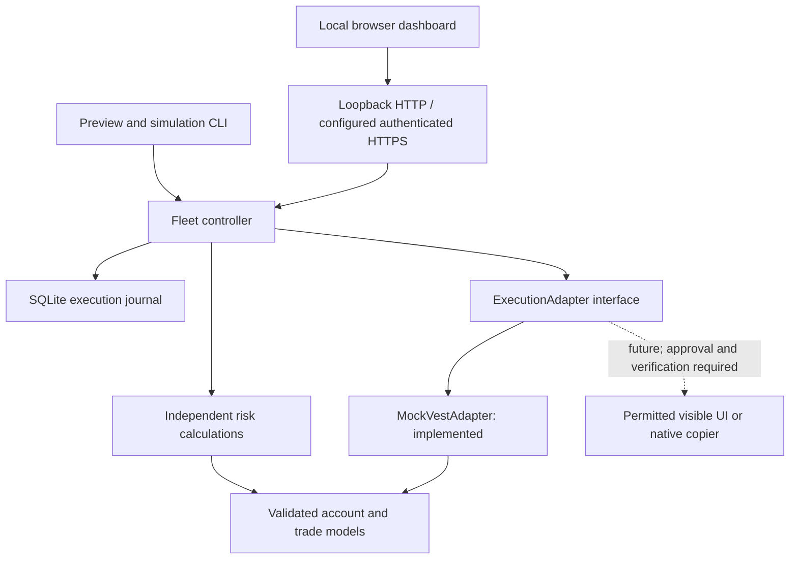
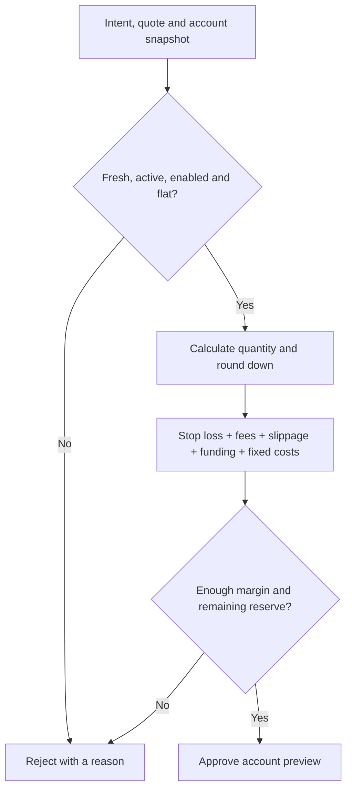

# Development guide

Engineering handoff, implementation reference and planning for `vest-fleet-controller`.
For installation and daily use, see the [README](README.md).

**Current direction:** follow the [implementation checklist](docs/implementation-checklist.md).
Phases 1–3 records, independent fan-out, readiness and channel contracts are verified
offline. Phase 4 original Vest integration and real context evidence are next.
Live trading remains locked. Earlier connection, platform and sequential-execution
notes below are historical wherever they conflict with that checklist.

Native host implementation, test evidence and remaining physical-device checks are
recorded in the [native validation report](docs/native-host-validation.md). Signed
Windows and Mac packages remain scheduled near final release, after acceptance.

## Current baseline

Customer deployment targets are Windows and macOS. Native identity, protected storage,
startup configuration and diagnostics are implemented; [desktop host acceptance](docs/desktop-host-support.md)
remains a release gate. Immediate work is Phase 4 original Vest integration.
Record native CI and physical device results separately from Linux evidence.

Mobile simulation and private HTTPS application work are now delivered around the
existing engine. See [the current validation report](docs/mobile-private-validation.md),
[access architecture](docs/private-access-architecture.md), and [host operations](docs/private-phone-access.md).
The earlier outage checkpoint is historical; its missing local application commit
was not recovered in this fresh clone. Implementation was reconstructed and verified.

The application provides a working local dashboard and CLI backed by the same
simulation controller. Live Vest execution is not implemented. The original simulation
baseline passed 155 tests in eight files; this is a dated result, not a guarantee about
subsequent changes. See the [validation record](docs/validation.md).

Recent completed work:

- Fixture-only browser adapter/coordinator and visible-DOM safety tests; funded API execution removed from the plan. Personal read-only inspection is owner-authorized; real UI evidence and automated execution review remain blockers.

- Independent sizing and margin-allocation controls for the ten-account fleet.
- Mandatory enabled-account same-market hedge guard, including unselected accounts.
- MARKET entry followed by authoritative fill reconciliation and separate reduce-only
  SL/TP orders anchored to the actual destination fill.
- Durable unprotected/protection-submitting states, protection-failure cleanup, circuit
  halt, sibling cancellation, idempotency and reconciliation tests.
- Refreshed browser screenshots, an exact execution diagram and a logo presentation.
  The full logo is in the README; SVG header, monochrome and favicon variants are implemented.

## Beta reliability update

The [reliability audit](docs/reliability-audit.md) classifies all 17 requested items,
records the implemented change set, and distinguishes simulator readiness from live
integration gates. Recovery is conservative: restart and reconciliation never re-arm.
An exclusive local owner lock prevents two dashboards using the same saved fleet.

## Documentation map

| Reference                                                                          | Use when working on                                                                      |
| ---------------------------------------------------------------------------------- | ---------------------------------------------------------------------------------------- |
| [Project specification and milestones](docs/project-plan.md)                       | Scope, original requirements and implementation sequence                                 |
| [Customer implementation and acceptance plan](docs/product-implementation-plan.md) | Sign-in/account connection, local and hosted workers, release sequence and failure tests |
| [Vest evidence register](docs/vest-facts.md)                                       | Official facts, reported observations, contradictions and verification gaps              |
| [Browser execution](docs/browser-execution.md)                                     | Policy/UI investigation, synthetic browser implementation and trial gates                |
| [Architecture](docs/architecture.md)                                               | Component ownership, boundaries and adapter capabilities                                 |
| [Risk model](docs/risk-model.md)                                                   | Decimal sizing, costs, reserve, fill anchors and exposure rules                          |
| [Execution model](docs/execution-model.md)                                         | States, request identity, protection, failures and emergency handling                    |
| [Simulator](docs/simulator.md)                                                     | Accounting, scenarios, assumptions and model limits                                      |
| [Validation record](docs/validation.md)                                            | Test coverage, measured results and unvalidated behavior                                 |
| [Native desktop host setup](docs/native-host-setup.md)                             | Windows/macOS development installation, private HTTPS, diagnostics and recovery          |
| [Desktop/physical-phone acceptance](docs/desktop-phone-sanity-check.md)            | Actual device evidence, Home Screen, suspension, sleep and reboot checks                 |
| [Visual assets](docs/visuals.md)                                                   | Branding, generation prompt and screenshot reproduction                                  |

Keep detailed design and evidence in those documents; keep the README focused on
what users can do and how to operate the application. Do not describe a planned
capability as shipped or remove the simulation-only boundary for presentation polish.

## Next development priorities

The current decision is an independent browser-first copier. Work from the actual
visible Vest UI and existing engine; stop routine Vest documentation/API research.
Preserve dated policy evidence, fail-closed behavior and all safety records.

1. Diagnose the quarantined browser closure and deliberate recovery before relaunch.
2. Inspect normal **Sign in with Google**; owner completes login/MFA directly. Implement
   a reviewed, exact authentication handoff, then return to one verified Vest page.
   Current popup/origin guards reject that handoff; Google login is not yet implemented.
3. Verify owner identity, discover funded inventory, inspect serialized account switching
   and existing fill/protection/close evidence without submitting orders.
4. Implement the real read-only evidence port with inspected semantic selectors and
   measured freshness/timing; missing values remain unknown, not simulator defaults.
5. Review capabilities/recovery before a separately authorized one-account execution
   trial. Reuse controller/risk/journals; halt ambiguous outcomes, never retry blindly.
6. Complete physical Windows/macOS and phone acceptance before customer invitations;
   signed installers remain near-final work. Manual leader-trade following is future work.

See [the current implementation order](docs/product-implementation-plan.md#browser-first-connection-milestone--current-decision)
and [the manual observation runbook](docs/vest-read-only-observation.md). No private
APIs, cookie/token replay, automated credential entry or real orders are authorized.

## Architecture

The core model and risk calculations have no Vest network dependency. Both the
simulator and any future permitted adapter must use the same trade intent and risk engine.



**Stack:** Node 24, TypeScript, pnpm, Zod, decimal.js, SQLite, Vitest, ESLint and
Prettier. The small workspace shares a root toolchain and uses direct TypeScript
imports between packages. The dashboard uses Node’s HTTP server and plain browser
JavaScript/CSS; it needs no frontend build step or additional runtime dependencies.

## Repository structure

| Location                               | Responsibility                                                        |
| -------------------------------------- | --------------------------------------------------------------------- |
| `apps/dashboard/server.ts`             | Loopback service, request validation and emergency coordination       |
| `apps/dashboard/public/`               | Browser controls, account table and simulation status                 |
| `docs/images/`                         | Application screenshots, execution diagram and logo concept           |
| `tests/dashboard.test.ts`              | HTTP security, execution, retry, reset and safety integration         |
| `apps/controller/src/cli.ts`           | Command parsing, preview output and scenario execution                |
| `packages/core/src/index.ts`           | Decimal primitives, schemas, account state and initial fleet          |
| `packages/risk-engine/src/exposure.ts` | Mandatory same-market hedge guard and future additive exposure rules  |
| `tests/hedge-guard.test.ts`            | Unit and simulator/controller hedge-policy tests                      |
| `packages/risk-engine/src/index.ts`    | Pure sizing, cost estimates and safety checks                         |
| `packages/execution/src/adapter.ts`    | Execution interface and response validation                           |
| `packages/execution/src/controller.ts` | Preview, dispatch, reconciliation and emergency control               |
| `packages/execution/src/journal.ts`    | SQLite identity records, circuit state and audit                      |
| `packages/simulator/src/index.ts`      | Mock adapter, fills, price/funding updates and withdrawals            |
| `tests/risk.test.ts`                   | Formulas, sizing and risk boundaries                                  |
| `tests/simulator.test.ts`              | Position accounting and simulator behavior                            |
| `tests/execution.test.ts`              | Failures, retry protection, reconciliation and restart cases          |
| `config/example.yaml`                  | Cost and safety assumptions                                           |
| `docs/`                                | Evidence register, architecture, risk/execution models and validation |

The dashboard reuses the same domain, risk engine, controller and simulator as the CLI.
There is no live-adapter implementation. Keep `main` simple; use `feature/*` when a change benefits from isolation.

## Development checks

The browser fixture update passed **155 tests in eight files**, strict TypeScript checks,
ESLint and formatting checks. See [validation results](docs/validation.md) for the tested
runtime, CLI checks and limits. This is a dated validation result, not a live CI badge.

```sh
pnpm test          # Run the test suite
pnpm typecheck     # Check strict TypeScript types
pnpm lint          # Run ESLint
pnpm format        # Apply formatting
pnpm format:check  # Check formatting without changing files
pnpm check         # Run all validation gates
```

There is no GitHub Actions workflow. Run `pnpm check` on the machine you claim
to have validated. Record the actual command, host, and result before calling a
platform validated.

To repeat the separate browser suite locally:

```sh
pnpm exec vitest run tests/browser-execution.test.ts tests/mobile-dashboard.test.ts tests/private-mobile.test.ts
```

Use `pnpm.cmd` for native PowerShell if `.ps1` execution is restricted; no policy
relaxation is needed. Actual phone Home Screen, screen lock and desktop sleep/reboot
remain [manual acceptance](docs/desktop-phone-sanity-check.md).

Useful invariants to preserve when extending the tool:

1. A retry cannot add another position.
2. Unknown execution is never interpreted as success or safely flat.
3. Every child is sized from its own account state.
4. Approved planned loss leaves the configured buffer under modeled assumptions.
5. Fees, funding and withdrawals are accounted for once.
6. Breached accounts never become active again merely because price recovers.
7. Journal-write failure cannot be ignored to continue submitting orders.
8. Entry fill alone is never establishment success: both reduce-only protections must be verified.
9. Final protection uses actual destination fill, never the preview quote.

## Roadmap and live integration gates

| Milestone            | Status                                         | Next requirement                                                                  |
| -------------------- | ---------------------------------------------- | --------------------------------------------------------------------------------- |
| M0: research         | Evidence register exists; key facts unresolved | Verify current Instant rules and supported execution                              |
| M1: core             | Implemented                                    | Extend only with verified rule/instrument metadata                                |
| M2: simulator        | Initial version implemented                    | Durable snapshots implemented; full deterministic event replay remains            |
| M3: controller       | Initial version implemented                    | Operator reconciliation; dashboard coordinates emergency handling                 |
| M4: dashboard        | Local simulator implemented                    | Durable halted recovery implemented; operator re-arm remains                      |
| M5: Vest integration | Deliberately blocked                           | Officially documented or explicitly permitted execution path                      |
| M6: validation       | Unit/integration/simulator stages only         | Paper environment if available, then separately authorized staged real validation |

Funded API execution is excluded by the current official FAQ, including Instant.
The current `BrowserExecutionAdapter` works only on local fixtures. A future permitted
visible-UI implementation or `VestNativeCopierAdapter` must pass the browser investigation gates.
A native copier must support the required independent follower sizing before it can
claim the same risk guarantees. Unsupported capabilities must fail explicitly.

Before any production execution integration, resolve account/contract scope and verify
automation/copy permissions, native copier status, authentication, symbol and market
increments, drawdown/daily limits, costs, funding, payouts, leverage, hedging restrictions,
termination rules, rate limits and server-side order protection/retry behavior.

Do not use undocumented/private endpoints for live execution or assume the standard
Vest exchange API can be used for Capital accounts. It cannot serve this funded fleet. Account observations belong in the
[evidence register](docs/vest-facts.md), with their uncertainty preserved.

Other current limits: one synthetic market, one net position per account, no order book,
no continuing/incremental partial-entry fill stream, no maintenance-margin liquidation model, no trading calendar,
no distributed worker failover (local execution has an exclusive runtime lock), no pyramiding/reversal and no live market data.

## Trade intent and CLI reference

A `TradeIntent` expresses the desired trade before per-account sizing:

```ts
{
  symbol: 'NDX',
  side: 'LONG',
  entryType: 'MARKET',
  stopDistancePoints: '80',
  takeProfitPoints: '80',
  riskMode: 'PERCENT_DRAWDOWN',
  riskValue: '40',
  leverage: '50'
}
```

`NQ` is the familiar display label. **`NDX` is an internal simulation symbol**;
`NDX-USD-PERP` is not a verified destination mapping. The browser investigation must
identify the visible funded market and its units; no Capital API mapping is being built.
This model represents a linear perpetual derivative, not a CME futures contract.

### Examples

```sh
# Short, $4 all-in risk, 60-point stop and 80-point target
pnpm preview --price 30400 --side SHORT --stop 60 --target 80 --mode FIXED_DOLLAR --risk 4

# $3,000 requested notional per account; unsafe accounts can be rejected
pnpm preview --mode FIXED_NOTIONAL --risk 3000

# A smaller percentage of each account's own remaining drawdown
pnpm preview --mode PERCENT_DRAWDOWN --risk 20

# Full machine-readable preview, including cost breakdown and rejection reasons
pnpm preview --json

# Use another assumption profile
pnpm preview --config config/example.yaml
```

| Option       | Default               | Meaning                                                                  |
| ------------ | --------------------- | ------------------------------------------------------------------------ |
| `--price`    | `30400`               | Synthetic quote; never fetched from a live feed                          |
| `--side`     | `LONG`                | `LONG` or `SHORT`                                                        |
| `--stop`     | `80`                  | Stop distance in index points                                            |
| `--target`   | `80`                  | Take-profit distance in index points                                     |
| `--mode`     | `PERCENT_DRAWDOWN`    | `MARGIN_PERCENT`, `FIXED_DOLLAR`, `PERCENT_DRAWDOWN` or `FIXED_NOTIONAL` |
| `--risk`     | `40`                  | Dollars, percent or notional according to mode; `40` means 40%, not 0.4% |
| `--leverage` | `50`                  | Requested leverage, checked against configuration and margin             |
| `--config`   | `config/example.yaml` | YAML cost and safety assumptions                                         |
| `--json`     | off                   | Full preview JSON; simulation commands also print subsequent results     |
| `--scenario` | `win`                 | Scenario applied by `simulate`                                           |

### Example output

At synthetic price **30,400**, long, 80-point stop/target, 40% all-in risk and the
example cost configuration:

| Accounts    | Balance | Floor | Buffer | All-in budget | Quantity / $ per point | Notional* |
| ----------- | ------: | ----: | -----: | ------------: | ---------------------: | --------: |
| 01          | $504.55 |  $490 | $14.55 |         $5.82 |               0.067228 | $2,043.73 |
| 02–10, each | $500.00 |  $490 | $10.00 |         $4.00 |               0.046205 | $1,404.63 |

\* Notional is rounded for display. Calculations retain decimal precision. These
are reproducible simulation examples, not current quotes or suggested trade sizes.

## How account risk works

### Start with the available buffer

```text
Effective floor = max(fixed drawdown floor, supplied daily-loss floor)
Equity = balance + unrealized P&L
Remaining drawdown = max(0, equity − effective floor)
```

The mock uses the observed $490 fixed floor. A supplied daily-loss floor can make
risk stricter; automatic daily-limit resets are not implemented because the applicable
Instant rules and reset semantics are unverified.

### Convert risk into position size

For price P, notional N and stop distance S:

```text
Dollars per point = N / P
Gross stop loss = (N / P) × S
Notional for gross risk R = R × P / S
```

For P=30,400, R=$4 and S=60, the gross formula gives approximately **$2,026.67**.
That is before costs. The executable sizing calculation reserves costs inside the
risk budget, so its approved notional is smaller.

| Mode                   | Calculation                                                                      |
| ---------------------- | -------------------------------------------------------------------------------- |
| Margin allocation      | Allocate equity × percentage as margin; multiply by leverage, then validate loss |
| Fixed dollar           | Input is the total planned loss budget, including costs                          |
| Percentage of drawdown | Budget = that account's buffer × percentage / 100                                |
| Fixed notional         | Convert requested notional to quantity, then validate its total loss and margin  |

Stop distance is required in all modes. In margin-allocation mode, changing leverage
changes exposure. At a fixed notional, leverage changes margin but not dollars per point.

### Include costs before approval



The default reserve is **$2 after the planned loss**. A $9 loss budget against a $10
buffer is rejected: it would leave only $1. Reaching the failure floor is rejected even
if the configured reserve is zero. Quantities always round down to the configured step.

A 40% budget against a $10 buffer allocates up to $4 to stop loss and costs, leaving
approximately $6 under the modeled assumptions. It does not guarantee that a gap,
unbounded funding charge or future venue failure cannot lose more.

See [the full risk model](docs/risk-model.md) for the cost coefficient, rounding,
account overrides and margin assumptions.

## Configuration

`config/example.yaml` contains **simulation assumptions**, not an official Vest fee schedule.
All decimal fields must be quoted strings; time limits are integer milliseconds.

| Setting                             | Example      | Meaning                                                               |
| ----------------------------------- | ------------ | --------------------------------------------------------------------- |
| `entryFeeRate`                      | `'0.000025'` | 0.0025% entry fee; user-observed, not officially verified             |
| `exitFeeRate`                       | `'0.000025'` | 0.0025% exit fee; user-observed, not officially verified              |
| `slippagePointsPerSide`             | `'1'`        | Adverse index points allowed at each execution                        |
| `fundingRateAllowance`              | `'0.0001'`   | Conservative funding fraction for the entire planned holding period   |
| `accountCost`                       | `'0'`        | Additional fixed cost per entry                                       |
| `minimumRemainingDrawdownAfterStop` | `'2'`        | Required remaining dollar buffer after planned loss                   |
| `sizeStep`                          | `'0.000001'` | Simulation quantity increment; actual market specification unverified |
| `maxLeverage`                       | `'50'`       | Configured leverage ceiling                                           |
| `maxDataAgeMs`                      | `5000`       | Maximum accepted account/quote age                                    |
| `maxPreviewAgeMs`                   | `5000`       | Maximum accepted preview age                                          |
| `maxPriceMovePoints`                | `'5'`        | Maximum quote movement from the preview before rejection              |

Account-specific fee and fixed-cost overrides are supported in the Account model.
Increasing fees or funding allowance reduces size for a fixed all-in budget. It does
not increase the allowed loss to preserve an earlier size.

## State, logs and restart behavior

| Data                           | Storage                            | Survives process exit? |
| ------------------------------ | ---------------------------------- | ---------------------- |
| Account balances and positions | Memory + dashboard SQLite snapshot | Yes, dashboard         |
| Mock order ledger              | Memory + dashboard SQLite snapshot | Yes, dashboard         |
| Preview objects                | Controller memory                  | No                     |
| Master/child execution records | `.runtime/<run-id>.sqlite`         | Yes                    |
| Structured audit events        | Same SQLite database               | Yes                    |
| Configured assumptions         | YAML and source control            | Yes                    |

SQLite records the child as submitting/unknown **before** invoking the adapter.
An unfinished master or unknown child halts a new controller using that journal.
There is no automatic re-arm or circuit-reset workflow. Restoring saved balances never authorizes new entries.
The dashboard restores its active session halted and reconciles before any further operation. It can explicitly start a new session while retaining previous journals. CLI runs remain isolated.

Audit records include timestamp, trade/account/request IDs, direction, requested and
filled quantity, protection levels, fees, status, error code, adapter and latency.
Simulator mutation events also cover price changes, funding, withdrawals and closes.
The logger uses an allowlist and fixed error codes instead of raw request or exception dumps.

The repository ignores runtime databases, `.env` files, logs, keys, dependencies and
build output. No Vest credentials are needed, collected or committed. Private phone
access stores a protected host secret and salted verifier outside source control;
the secret is never printed in diagnostics. `.env.example` contains comments only.
A private repository is still not a place to store credentials.

## Visual identity follow-up

The generated logo is embedded at the top of the user README. Preserve that approved
placement. The dashboard now uses an editable transparent SVG mark, with a simplified
favicon and a monochrome variant under `apps/dashboard/public/brand/`. The original prompt and source reference are
recorded in [visual asset notes](docs/visuals.md). Technical diagrams must remain exact;
application screenshots must come from the running simulator, not generated mockups.

## Maintenance checklist

- Preserve idempotency, journaling, pre-trade revalidation, hedge rules and emergency flatten.
- Do not declare establishment successful until entry and both protections reconcile.
- Update the relevant design documents when behavior changes; update user instructions
  only when the controls or operational behavior change.
- Run the relevant tests and required formatting/lint/type checks for code changes.
- Regenerate screenshots with `scripts/capture-visuals.mjs` when visible behavior changes.
- Keep credentials, runtime databases, logs and temporary tooling out of commits.
- Use `main` and focused feature branches when useful; avoid unnecessary process.

## Browser fixture development

The new browser package is disconnected from production. It uses the existing risk and
execution logic through a synthetic visible-DOM contract, not Vest selectors or cookies.
See [browser architecture and blockers](docs/browser-execution.md). Install the pinned
browser development dependency with `pnpm install --frozen-lockfile`, then install local
test Chromium with `pnpm exec playwright install chromium` before `pnpm check`.
Use `BROWSER_TEST_EXECUTABLE` only to select an already installed local test binary.
No target URL, persistent profile or real-account login is accepted by the test harness.
