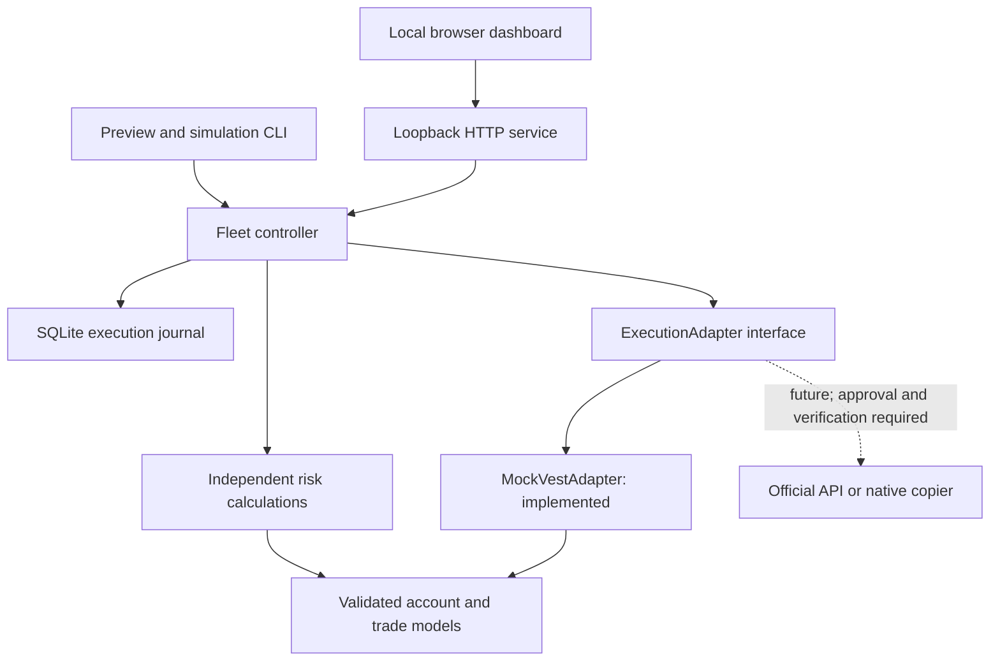
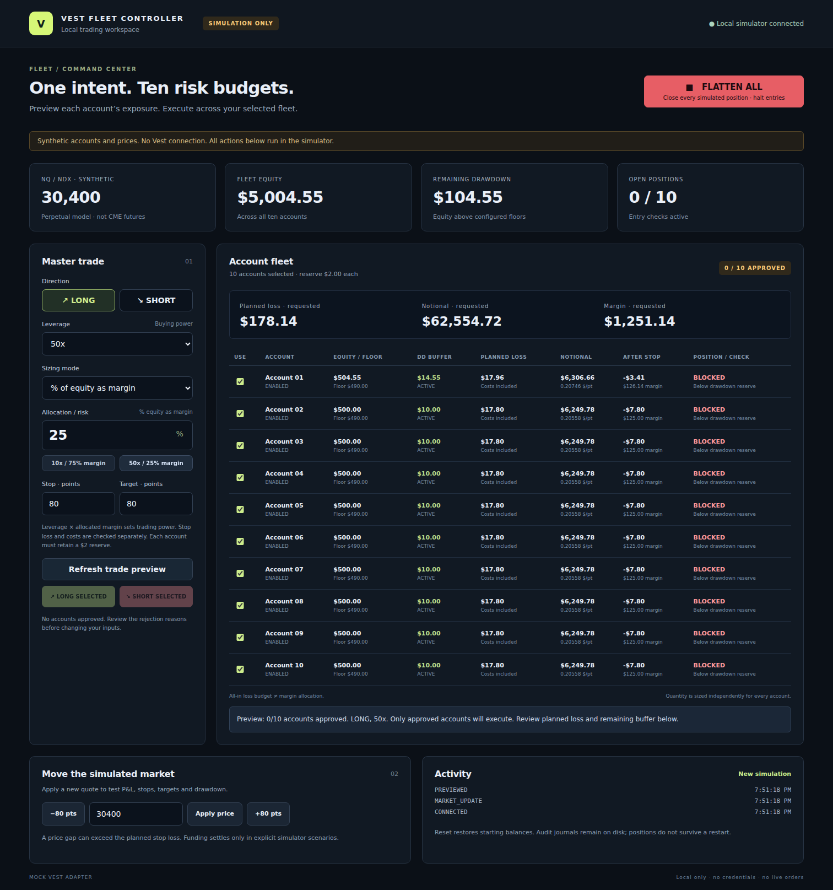
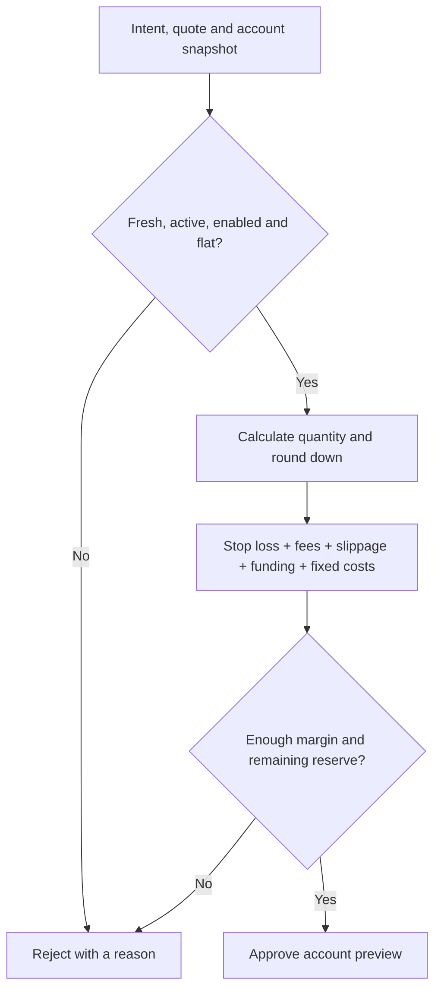

# Vest Fleet Controller

**One trade intent. Independent account risk. Explicit execution outcomes.**

A local TypeScript tool for managing a fleet of Vest Capital accounts, previewing
risk-adjusted orders, and testing execution behavior before any supported live integration.
The initial fleet models **10 × $500 Instant funded accounts**.

> **Current release: simulation only.** Prices and accounts are synthetic. There is no
> live Vest adapter, authenticated market feed, or credential setup.
> Both a local browser dashboard and CLI are available.
> The code cannot send a live Vest trade.


_Actual application screenshot, using synthetic accounts and prices._

## Contents

- [What the tool does](#what-the-tool-does)
- [Architecture](#architecture)
- [Quick start](#quick-start)
- [Using the web dashboard](#using-the-web-dashboard)
- [Trading power: leverage × allocation](#trading-power-leverage--allocation)
- [Trade previews](#trade-previews)
- [How account risk works](#how-account-risk-works)
- [Execution and failure handling](#execution-and-failure-handling)
- [Simulator scenarios](#simulator-scenarios)
- [Configuration](#configuration)
- [State, logs and restart behavior](#state-logs-and-restart-behavior)
- [Repository structure](#repository-structure)
- [Verification and development](#verification-and-development)
- [Roadmap and live integration gates](#roadmap-and-live-integration-gates)
- [Troubleshooting](#troubleshooting)
- [Further reading](#further-reading)

## What the tool does

Copying the same order size into every account assumes the accounts have the same
risk capacity. This tool calculates each account's order separately, using its own
equity, failure floor, costs and remaining buffer.

| Capability        | Current implementation                                                                    |
| ----------------- | ----------------------------------------------------------------------------------------- |
| Account inventory | Balance, equity, P&L, floor, buffer, leverage, positions, status and synchronization time |
| Trade intent      | Direction, market entry, stop/target distance, risk mode/value and leverage               |
| Risk sizing       | Margin allocation × leverage, fixed dollar loss, drawdown percentage, or fixed notional   |
| Cost model        | Entry/exit fees, adverse slippage, funding allowance and account-specific costs           |
| Preview           | Per-account size, notional, estimated loss, remaining buffer and rejection reasons        |
| Execution         | Sequential mock dispatch with fresh validation before each child order                    |
| Reconciliation    | Compare acknowledgement, order ledger and protected position                              |
| Retry protection  | Deterministic child IDs and SQLite records written before submission                      |
| Emergency control | Block new entries, attempt flattening every account, then verify positions                |
| Simulation        | Ten independent accounts, price changes, stops/targets, costs, breaches and failures      |
| Observability     | Structured, allowlisted audit records and explicit unknown outcomes                       |

The account manager currently lives in the validated account model and mock adapter.
The local dashboard keeps one simulated fleet running until you reset it or stop the server.
The CLI runs isolated scenarios. Neither interface automates Vest’s website.

## Architecture

The core model and risk calculations have no Vest network dependency. Both the
simulator and any future permitted adapter must use the same trade intent and risk engine.



**Stack:** Node 24, TypeScript, pnpm, Zod, decimal.js, SQLite, Vitest, ESLint and
Prettier. The small workspace shares a root toolchain and uses direct TypeScript
imports between packages. The dashboard uses Node’s HTTP server and plain browser
JavaScript/CSS; it needs no frontend build step or additional runtime dependencies.

## Quick start

### Prerequisites

- Node.js **24.x**; initial validation used **24.19.0**.
- pnpm **11.25.0**, matching `packageManager` in `package.json`.
- A terminal in the project directory. No Vest login or API key is required.

Clone the private repository with your authenticated GitHub account:

```sh
git clone https://github.com/Mahdi451/vest-fleet-controller.git
cd vest-fleet-controller
```

If you have the downloaded archive, extract it and enter `vest-fleet-controller/`.
It contains a `history.bundle`; the archive's `RESTORE.txt` explains how to restore
Git history when needed. If you have a repository checkout, use its root directory.

### Install, verify and preview

```sh
pnpm install --frozen-lockfile
pnpm check
pnpm dashboard
```

`pnpm check` runs strict TypeScript checking, ESLint, formatting checks and tests.
Open **http://127.0.0.1:4173** in your browser. Keep the terminal running.
Use `Ctrl+C` to stop the server.

For terminal-only usage, `pnpm preview` calculates orders without submitting even mock entries.

### Run an isolated simulation

```sh
pnpm simulate --scenario win
pnpm simulate --scenario partial-failure
pnpm simulate --scenario retry
```

Every CLI invocation creates a **new simulated fleet** and a separate local journal.
Running another command does not resume the previous simulation's balances or positions.

## Using the web dashboard

1. Choose **LONG** or **SHORT** in the direction selector.
2. Set **leverage** and **% of equity as margin**, or choose a preset.
3. Set the **stop and target distances** in points.
4. Select the participating accounts using the checkboxes.
5. Click **Refresh trade preview**. Review each account’s margin, notional,
   planned loss, remaining drawdown and approval status.
6. Click **LONG SELECTED** or **SHORT SELECTED** within five seconds. Only
   approved accounts execute. Presets calculate previews; they do not place orders.
7. Use the synthetic price controls to test price moves, stops and targets.
8. **FLATTEN ALL** closes every simulated account, including accounts not selected,
   and latches the entry halt. It does not require a confirmation dialog.

Changing an input or account selection invalidates the preview. Expired previews must
be refreshed. LONG and SHORT are not reversal buttons: existing positions must close
before a new trade can be opened. A dropped execution response disables further entries;
use flatten and inspect outcomes instead of blindly clicking again.

After emergency flatten, **New simulation** explicitly resets balances, positions and
entry state to the initial fleet. It asks for confirmation because it discards simulated
state. There is currently no re-arm-and-preserve-balances workflow. Audit files remain
under `.runtime/dashboard/<session-id>.sqlite`.


A [mobile layout screenshot](docs/images/dashboard-mobile.png) shows the same protected-position state. These captures include the post-fill protection refactor.

The service listens only on `127.0.0.1:4173`; use that exact address, not `localhost`.
Host/Origin checks, a mutation token, a restrictive content security policy and no CORS
limit access from other websites. This is a local simulator, not a remotely authenticated
trading service. Do not expose it to a LAN or reverse proxy.

## Trading power: leverage × allocation

**Allocation means the percentage of account equity committed as margin. It is not
percentage of drawdown risk.** This is the dashboard’s default sizing mode,
`MARGIN_PERCENT`. Other risk modes remain available in the dropdown and CLI.

```text
margin allocation = min(balance, equity) × allocation percent / 100
buying power      = margin allocation × leverage
quantity          = round_down(buying power / adverse entry price)
planned loss      = quantity × stop distance + modeled costs
```

The model requires flat accounts before opening new positions, so it does not pretend
to calculate free collateral for an existing portfolio. It uses `price + entry slippage`
for conservative sizing in either direction. Rounding and slippage make the displayed
quote-based notional slightly smaller than the simple buying-power amount.

For a $500 account at a synthetic price of 30,400:

| Leverage | Equity allocation | Margin | Approximate buying power | Stop-only loss at 80 points, before costs |
| -------- | ----------------: | -----: | -----------------------: | ----------------------------------------: |
| 10x      |               25% |   $125 |                   $1,250 |                                     $3.29 |
| 10x      |               75% |   $375 |                   $3,750 |                                     $9.87 |
| 50x      |               25% |   $125 |                   $6,250 |                                    $16.45 |

At a $10 drawdown buffer and $2 reserve, the last two examples are **rejected** after
costs. A higher account buffer can produce a different decision: Account 01 can approve
10x/75% under the example assumptions while Accounts 02–10 reject it. Preview totals
show **all requested exposure**, including rejected accounts; only approved rows execute.
The controller never silently shrinks a requested margin allocation to make it pass.



Leverage multiplies exposure when margin allocation is held constant. In a fixed-dollar
loss or drawdown-risk mode, the stop and loss budget determine size; leverage primarily
changes required margin. Always check the sizing-mode label.

CLI equivalent:

```sh
pnpm preview --mode MARGIN_PERCENT --risk 75 --leverage 10 --stop 80
pnpm preview --mode MARGIN_PERCENT --risk 25 --leverage 50 --stop 80
```

## Trade previews

A `TradeIntent` expresses the desired trade before per-account sizing:

```ts
{
  symbol: 'NDX',
  side: 'LONG',
  entryType: 'MARKET',
  stopDistancePoints: '80',
  takeProfitPoints: '80',
  riskMode: 'PERCENT_DRAWDOWN',
  riskValue: '40',
  leverage: '50'
}
```

`NQ` is the familiar display label. **`NDX` is an internal simulation symbol**;
`NDX-USD-PERP` has not been verified as the correct supported Capital API mapping.
This model represents a linear perpetual derivative, not a CME futures contract.

### Examples

```sh
# Short, $4 all-in risk, 60-point stop and 80-point target
pnpm preview --price 30400 --side SHORT --stop 60 --target 80 --mode FIXED_DOLLAR --risk 4

# $3,000 requested notional per account; unsafe accounts can be rejected
pnpm preview --mode FIXED_NOTIONAL --risk 3000

# A smaller percentage of each account's own remaining drawdown
pnpm preview --mode PERCENT_DRAWDOWN --risk 20

# Full machine-readable preview, including cost breakdown and rejection reasons
pnpm preview --json

# Use another assumption profile
pnpm preview --config config/example.yaml
```

| Option       | Default               | Meaning                                                                  |
| ------------ | --------------------- | ------------------------------------------------------------------------ |
| `--price`    | `30400`               | Synthetic quote; never fetched from a live feed                          |
| `--side`     | `LONG`                | `LONG` or `SHORT`                                                        |
| `--stop`     | `80`                  | Stop distance in index points                                            |
| `--target`   | `80`                  | Take-profit distance in index points                                     |
| `--mode`     | `PERCENT_DRAWDOWN`    | `MARGIN_PERCENT`, `FIXED_DOLLAR`, `PERCENT_DRAWDOWN` or `FIXED_NOTIONAL` |
| `--risk`     | `40`                  | Dollars, percent or notional according to mode; `40` means 40%, not 0.4% |
| `--leverage` | `50`                  | Requested leverage, checked against configuration and margin             |
| `--config`   | `config/example.yaml` | YAML cost and safety assumptions                                         |
| `--json`     | off                   | Full preview JSON; simulation commands also print subsequent results     |
| `--scenario` | `win`                 | Scenario applied by `simulate`                                           |

### Example output

At synthetic price **30,400**, long, 80-point stop/target, 40% all-in risk and the
example cost configuration:

| Accounts    | Balance | Floor | Buffer | All-in budget | Quantity / $ per point | Notional* |
| ----------- | ------: | ----: | -----: | ------------: | ---------------------: | --------: |
| 01          | $504.55 |  $490 | $14.55 |         $5.82 |               0.067228 | $2,043.73 |
| 02–10, each | $500.00 |  $490 | $10.00 |         $4.00 |               0.046205 | $1,404.63 |

\* Notional is rounded for display. Calculations retain decimal precision. These
are reproducible simulation examples, not current quotes or suggested trade sizes.

## How account risk works

### Start with the available buffer

```text
Effective floor = max(fixed drawdown floor, supplied daily-loss floor)
Equity = balance + unrealized P&L
Remaining drawdown = max(0, equity − effective floor)
```

The mock uses the observed $490 fixed floor. A supplied daily-loss floor can make
risk stricter; automatic daily-limit resets are not implemented because the applicable
Instant rules and reset semantics are unverified.

### Convert risk into position size

For price P, notional N and stop distance S:

```text
Dollars per point = N / P
Gross stop loss = (N / P) × S
Notional for gross risk R = R × P / S
```

For P=30,400, R=$4 and S=60, the gross formula gives approximately **$2,026.67**.
That is before costs. The executable sizing calculation reserves costs inside the
risk budget, so its approved notional is smaller.

| Mode                   | Calculation                                                                      |
| ---------------------- | -------------------------------------------------------------------------------- |
| Margin allocation      | Allocate equity × percentage as margin; multiply by leverage, then validate loss |
| Fixed dollar           | Input is the total planned loss budget, including costs                          |
| Percentage of drawdown | Budget = that account's buffer × percentage / 100                                |
| Fixed notional         | Convert requested notional to quantity, then validate its total loss and margin  |

Stop distance is required in all modes. In margin-allocation mode, changing leverage
changes exposure. At a fixed notional, leverage changes margin but not dollars per point.

### Include costs before approval



The default reserve is **$2 after the planned loss**. A $9 loss budget against a $10
buffer is rejected: it would leave only $1. Reaching the failure floor is rejected even
if the configured reserve is zero. Quantities always round down to the configured step.

A 40% budget against a $10 buffer allocates up to $4 to stop loss and costs, leaving
approximately $6 under the modeled assumptions. It does not guarantee that a gap,
unbounded funding charge or future venue failure cannot lose more.

See [the full risk model](docs/risk-model.md) for the cost coefficient, rounding,
account overrides and margin assumptions.

## Execution and failure handling

The controller stores a preview, then rechecks each participating account before
submitting its independently sized child order. Dispatch is sequential in this release.
A child may not grow beyond the preview quantity.


_Exact execution diagram; editable [SVG source](docs/images/execution-flow.svg)._

MARKET entry is submitted alone. SL/TP prices are calculated only after authoritative
fill confirmation, then submitted as separate reduce-only orders. For a LONG fill at
30,450.25 with 25-point SL and 50-point TP, final prices are **30,425.25 / 30,500.25**.
Preview levels are estimates. A CME/signal source may choose direction; destination
fill always anchors protection.

An unprotected filled position is unsafe. Failure to establish either SL or TP causes
an immediate account-flatten attempt, an `UNKNOWN` child result and a controller halt.
Later accounts are `HALTED`. Successful cleanup is recorded separately; it does not
turn failed establishment into success. TP/SL exits cancel their sibling in the
simulator, with entry-linked reduce-only checks preventing exposure reversal. No
venue-native OCO is assumed.

An account rejected during preview is skipped. An unexpected failure on a previously
approved account halts the remaining dispatch. Existing successful fills are not
silently rolled back; their simulated stop/target protection remains active.

| Example event                                        | Controller behavior                                                                                |
| ---------------------------------------------------- | -------------------------------------------------------------------------------------------------- |
| Accounts 01–07 fill, 08 rejects                      | Record seven fills and the rejection; do not send entries to 09–10                                 |
| Response times out                                   | Keep outcome unknown; block further entries; do not automatically resend                           |
| Response is ambiguous, but ledger and position agree | Verify entry, then create and verify SL/TP before reporting PROTECTED                              |
| Same master ID and same preview are retried          | Return the recorded result without resubmission                                                    |
| Same master ID is reused for another preview         | Reject the identity conflict                                                                       |
| Price or account state changes after preview         | Revalidate; reject if the preview is no longer safe                                                |
| Another account holds the opposite direction         | Block opposing same-market entries when that account is enabled; unselected enabled accounts count |
| A response names the wrong account                   | Preserve the requested identity, mark unknown and halt                                             |

A historical `FILLED` / `PROTECTED` result is not a current-position query. An exact replay can
still return the original fill after that position has been closed.

### Mandatory hedge guard

`CROSS_ACCOUNT_HEDGE_GUARD = ENABLED` is a hard entry rule, with no disable setting.
Same-direction copying into flat accounts passes this guard. Opposite-direction NQ/NDX
entries fail whenever another **enabled** account holds that market in the other direction.
All enabled accounts count, including accounts not selected for the new trade. Disabled
accounts are ignored per the specified policy; unchecking a dashboard account only
changes participation and does **not** disable it. Disabling does not close its positions
or establish an exemption under Vest's rules.

The rule runs in preview, before each child dispatch, and in the mock adapter. Preview
responses include the conflicting account, symbol and direction. Emergency flatten is
always permitted. No automatic correlated-market blocking is enabled; the exposure-rule
interface can add a future verified policy. Current executable intents remain NDX-only.
See the [exact behavior matrix](docs/risk-model.md#mandatory-cross-account-hedge-guard)
and [policy evidence status](docs/vest-facts.md#hedge-policy-requirement-update--2026-09-29).

### Emergency flatten

`FleetController.flattenAll()` latches the entry circuit, includes disabled accounts,
attempts every account, and reads positions afterward. An account with an unresolved
submission remains `UNKNOWN` even if its current position snapshot is empty.

The dashboard first latches the controller halt, waits for its current bounded operation,
and then runs flatten automatically. Failures remain explicit and the button stays
available for retry. The lower-level `flattenAll()` call itself still requires a retry
when called directly during execution; the dashboard supplies that coordination.

There is no standalone interactive flatten CLI. Scenario commands exercise flatten at
the end of the run. A successful flatten keeps entries halted until a new simulation.

## Simulator scenarios

Run `pnpm simulate --scenario <name>`. All scenarios use the same domain and risk logic.

| Scenario          | What happens                                              | What it demonstrates                                 |
| ----------------- | --------------------------------------------------------- | ---------------------------------------------------- |
| `win`             | Price moves to the target                                 | All-account favorable exit and net accounting        |
| `loss`            | Price moves to the stop                                   | Planned loss and configured execution costs          |
| `partial-failure` | Account 08 rejects                                        | Partial success and halted remaining dispatch        |
| `ambiguous`       | Account 10 fills but returns an uncertain acknowledgement | Reconciliation without duplicate entry               |
| `timeout`         | Account 09 returns an unresolved timeout                  | Unknown state and blocked account 10                 |
| `disabled`        | Account 10 is disabled before preview                     | Nine participating accounts                          |
| `gap`             | Price jumps adversely by five stop distances              | Loss can exceed the planned stop and breach accounts |
| `retry`           | The same master request is executed twice                 | Recorded replay without increasing exposure          |

After execution, each scenario applies its price move and calls emergency flatten.
This is a finite demonstration, not an interactive session. The tests additionally
exercise partial closes, signed funding, withdrawals, stale snapshots, true hanging
adapter calls and controller restart against an existing journal.

Funding settlement and profit withdrawals are available through the mock's programmatic
methods. Funding is explicitly applied as a scenario rate and duration; it does not
accrue automatically with wall-clock time. Withdrawals debit gross profit and calculate
the supplied share, while retaining the assumed fixed floor.

## Configuration

`config/example.yaml` contains **simulation assumptions**, not an official Vest fee schedule.
All decimal fields must be quoted strings; time limits are integer milliseconds.

| Setting                             | Example      | Meaning                                                               |
| ----------------------------------- | ------------ | --------------------------------------------------------------------- |
| `entryFeeRate`                      | `'0.000025'` | 0.0025% entry fee; user-observed, not officially verified             |
| `exitFeeRate`                       | `'0.000025'` | 0.0025% exit fee; user-observed, not officially verified              |
| `slippagePointsPerSide`             | `'1'`        | Adverse index points allowed at each execution                        |
| `fundingRateAllowance`              | `'0.0001'`   | Conservative funding fraction for the entire planned holding period   |
| `accountCost`                       | `'0'`        | Additional fixed cost per entry                                       |
| `minimumRemainingDrawdownAfterStop` | `'2'`        | Required remaining dollar buffer after planned loss                   |
| `sizeStep`                          | `'0.000001'` | Simulation quantity increment; actual market specification unverified |
| `maxLeverage`                       | `'50'`       | Configured leverage ceiling                                           |
| `maxDataAgeMs`                      | `5000`       | Maximum accepted account/quote age                                    |
| `maxPreviewAgeMs`                   | `5000`       | Maximum accepted preview age                                          |
| `maxPriceMovePoints`                | `'5'`        | Maximum quote movement from the preview before rejection              |

Account-specific fee and fixed-cost overrides are supported in the Account model.
Increasing fees or funding allowance reduces size for a fixed all-in budget. It does
not increase the allowed loss to preserve an earlier size.

## State, logs and restart behavior

| Data                           | Storage                    | Survives process exit? |
| ------------------------------ | -------------------------- | ---------------------- |
| Account balances and positions | Mock adapter memory        | No                     |
| Mock order ledger              | Mock adapter memory        | No                     |
| Preview objects                | Controller memory          | No                     |
| Master/child execution records | `.runtime/<run-id>.sqlite` | Yes                    |
| Structured audit events        | Same SQLite database       | Yes                    |
| Configured assumptions         | YAML and source control    | Yes                    |

SQLite records the child as submitting/unknown **before** invoking the adapter.
An unfinished master or unknown child halts a new controller using that journal.
There is no automatic recovery or circuit-reset workflow that preserves simulated balances.
The dashboard can explicitly discard its current simulated fleet and start a new session.

Audit records include timestamp, trade/account/request IDs, direction, requested and
filled quantity, protection levels, fees, status, error code, adapter and latency.
Simulator mutation events also cover price changes, funding, withdrawals and closes.
The logger uses an allowlist and fixed error codes instead of raw request or exception dumps.

The repository ignores runtime databases, `.env` files, logs, keys, dependencies and
build output. No credentials are needed, collected or committed. `.env.example` contains
comments only. A private repository is still not a place to store credentials.

## Repository structure

| Location                               | Responsibility                                                        |
| -------------------------------------- | --------------------------------------------------------------------- |
| `apps/dashboard/server.ts`             | Loopback service, request validation and emergency coordination       |
| `apps/dashboard/public/`               | Browser controls, account table and simulation status                 |
| `docs/images/`                         | Application screenshots, execution diagram and logo concept           |
| `tests/dashboard.test.ts`              | HTTP security, execution, retry, reset and safety integration         |
| `apps/controller/src/cli.ts`           | Command parsing, preview output and scenario execution                |
| `packages/core/src/index.ts`           | Decimal primitives, schemas, account state and initial fleet          |
| `packages/risk-engine/src/exposure.ts` | Mandatory same-market hedge guard and future additive exposure rules  |
| `tests/hedge-guard.test.ts`            | Unit and simulator/controller hedge-policy tests                      |
| `packages/risk-engine/src/index.ts`    | Pure sizing, cost estimates and safety checks                         |
| `packages/execution/src/adapter.ts`    | Execution interface and response validation                           |
| `packages/execution/src/controller.ts` | Preview, dispatch, reconciliation and emergency control               |
| `packages/execution/src/journal.ts`    | SQLite identity records, circuit state and audit                      |
| `packages/simulator/src/index.ts`      | Mock adapter, fills, price/funding updates and withdrawals            |
| `tests/risk.test.ts`                   | Formulas, sizing and risk boundaries                                  |
| `tests/simulator.test.ts`              | Position accounting and simulator behavior                            |
| `tests/execution.test.ts`              | Failures, retry protection, reconciliation and restart cases          |
| `config/example.yaml`                  | Cost and safety assumptions                                           |
| `docs/`                                | Evidence register, architecture, risk/execution models and validation |

The dashboard reuses the same domain, risk engine, controller and simulator as the CLI.
There is no live-adapter shell. Keep `main` simple; use `feature/*` when a change benefits from isolation.

## Verification and development

The post-fill protection release passed **96 tests in six files**, strict TypeScript checks,
ESLint and formatting checks. See [validation results](docs/validation.md) for the tested
runtime, CLI checks and limits. This is a dated validation result, not a live CI badge.

```sh
pnpm test          # Run the test suite
pnpm typecheck     # Check strict TypeScript types
pnpm lint          # Run ESLint
pnpm format        # Apply formatting
pnpm format:check  # Check formatting without changing files
pnpm check         # Run all validation gates
```

Useful invariants to preserve when extending the tool:

1. A retry cannot add another position.
2. Unknown execution is never interpreted as success or safely flat.
3. Every child is sized from its own account state.
4. Approved planned loss leaves the configured buffer under modeled assumptions.
5. Fees, funding and withdrawals are accounted for once.
6. Breached accounts never become active again merely because price recovers.
7. Journal-write failure cannot be ignored to continue submitting orders.
8. Entry fill alone is never establishment success: both reduce-only protections must be verified.
9. Final protection uses actual destination fill, never the preview quote.

## Roadmap and live integration gates

| Milestone            | Status                                         | Next requirement                                                                  |
| -------------------- | ---------------------------------------------- | --------------------------------------------------------------------------------- |
| M0: research         | Evidence register exists; key facts unresolved | Verify current Instant rules and supported execution                              |
| M1: core             | Implemented                                    | Extend only with verified rule/instrument metadata                                |
| M2: simulator        | Initial version implemented                    | Persist simulator snapshots and deterministic recovery                            |
| M3: controller       | Initial version implemented                    | Operator reconciliation; dashboard coordinates emergency handling                 |
| M4: dashboard        | Local simulator implemented                    | Persistent recovery and operator re-arm workflow remain                           |
| M5: Vest integration | Deliberately blocked                           | Officially documented or explicitly permitted execution path                      |
| M6: validation       | Unit/integration/simulator stages only         | Paper environment if available, then separately authorized staged real validation |

Possible future adapters are `VestOfficialApiAdapter` and `VestNativeCopierAdapter`.
A native copier must support the required independent follower sizing before it can
claim the same risk guarantees. Unsupported capabilities must fail explicitly.

Before implementing either adapter, verify funded-account limits, Instant inclusion,
automation/copy permissions, native copier status, authentication, symbol and market
increments, drawdown/daily limits, costs, funding, payouts, leverage, hedging restrictions,
termination rules, rate limits and server-side order protection/retry behavior.

Do not use undocumented/private endpoints for live execution or assume the standard
Vest exchange API supports Capital accounts. Account observations belong in the
[evidence register](docs/vest-facts.md), with their uncertainty preserved.

Other current limits: one synthetic market, one net position per account, no order book,
no partial entry fills, no maintenance-margin liquidation model, no trading calendar,
no multi-process coordination, no pyramiding/reversal and no live market data.

## Troubleshooting

| Symptom                                           | Meaning / next action                                                                         |
| ------------------------------------------------- | --------------------------------------------------------------------------------------------- |
| `COMMAND_FAILED`                                  | Check option names, allowed modes and quoted decimal values in YAML; run `pnpm check`         |
| `DRAWDOWN_RESERVE`                                | Planned loss leaves too little buffer; reduce risk or omit that account                       |
| `INSUFFICIENT_MARGIN`                             | Estimated margin plus entry costs exceeds available cash/equity                               |
| `STALE_ACCOUNT`, `STALE_QUOTE`, `PREVIEW_EXPIRED` | Obtain fresh state and a new preview; do not blindly resend                                   |
| `EXISTING_POSITION`                               | Initial implementation requires a flat destination account                                    |
| `CROSS_ACCOUNT_HEDGE_GUARD`                       | An enabled account has opposite same-market exposure; disabled accounts are ignored           |
| `IDEMPOTENCY_CONFLICT`                            | An existing master/request ID was reused with a different payload                             |
| `UNKNOWN` or `RECONCILIATION_REQUIRED`            | Preserve the journal and reconcile the outcome; do not retry entry                            |
| `EXECUTION_IN_PROGRESS_RETRY_FLATTEN`             | Entry halt is latched; call flatten after the active operation completes                      |
| A new CLI run shows starting balances             | Expected: each command starts an isolated simulation                                          |
| A stop loses more than expected                   | The current synthetic quote can gap through the stop; fills are not guaranteed at the trigger |

The CLI uses Node's `--import tsx` loader so it does not depend on the separate `tsx`
CLI's IPC listener. Use the documented pnpm scripts in restricted execution environments.

## Visual identity concept


An original fleet-mark concept inspired by the geometric restraint of Vest Markets,
with an independent silhouette and wordmark. This is a branding exploration, not an
approved production icon or an official Vest identity. The dashboard keeps its current
identity while the concept is reviewed. A clean SVG, small-size icon and monochrome
variant are the next design steps if this direction is selected.

[Visual asset notes, generation prompt and screenshot reproduction](docs/visuals.md).

## Further reading

- [Combined project specification and milestones](docs/project-plan.md)
- [Vest facts: confirmed, likely, unverified and contradicted](docs/vest-facts.md)
- [Architecture and major assumptions](docs/architecture.md)
- [Detailed risk calculations](docs/risk-model.md)
- [Execution and reliability model](docs/execution-model.md)
- [Simulator behavior and boundaries](docs/simulator.md)
- [Initial validation report](docs/validation.md)
