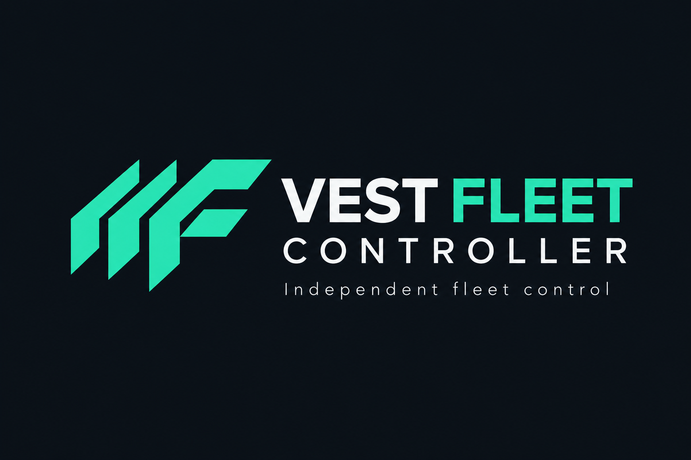
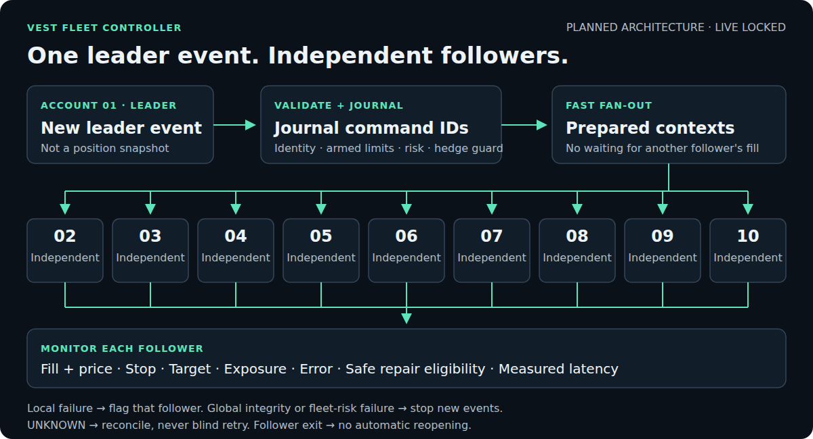
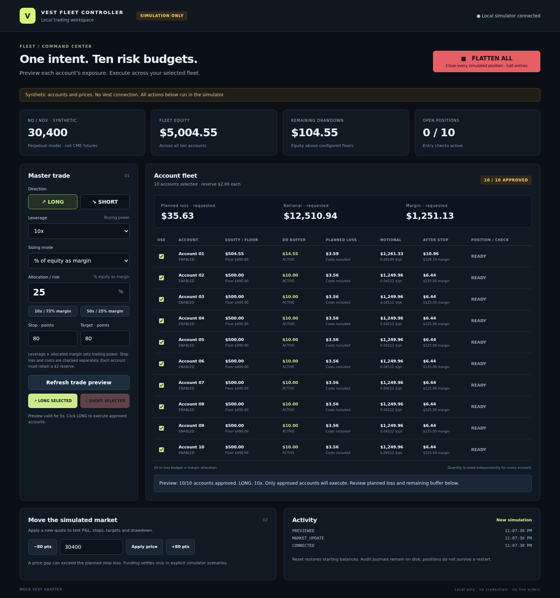

<p align="center">
  
</p>

# Vest Fleet Controller

A private, locally controlled Vest copy trader in development. Account 01 leads;
Accounts 02–10 will copy genuine leader events through independent follower execution,
with account-specific risk limits and clear outcomes.

**Version 0.1.1 · Offline prototype · Live trading LOCKED**

The current dashboard and CLI operate on synthetic accounts and prices. They do not
connect to Vest or place live trades. This is an independent tool, not an official
Vest product.

**Chosen target:** local controller and dashboard with a dedicated managed Vest
browser; no Chrome extension required. The original browser adapter remains to be
implemented and proven. See the [target decision](docs/fanout-adoption-plan.md#chosen-runtime-target).

## Current state

| Component                                            | Status                                                                             |
| ---------------------------------------------------- | ---------------------------------------------------------------------------------- |
| Simulation dashboard and CLI                         | Working with synthetic data                                                        |
| Risk engine, hedge guard and journal                 | Integrated into synthetic concurrent execution; pending/UNKNOWN exposure reserved  |
| Leader events and follower records                   | Phase 1 verified offline: durable identity, atomic claims and independent outcomes |
| Fast follower fan-out                                | Phase 2 verified offline; additive synthetic dashboard now available               |
| Session arming, readiness and secure browser channel | Fixture contracts and managed pages verified; Vest readiness unproven              |
| Managed browser lifecycle                            | Persistent headless namespace fixtures verified; authentic Vest profile unproven   |
| Vest execution and reconciliation                    | Original fixture evidence contracts added; connected implementation unproven       |
| Follower repair controls and latency metrics         | Verified offline; scoped repairs, latency and headless dashboard tests pass        |
| Funded-account execution                             | Locked; requires separate evidence, review and authorization                       |

Phase 1 added **61 tests** covering duplicate events, competing processes, restart
recovery, safe retry eligibility, no-reopen records and storage integrity. Independent
review findings were resolved, and all six local verification checks passed at that
checkpoint. Phase 2 adds independent account lanes, durable batch replay and atomic
pending-exposure hedge protection, with 40 fan-out/exposure tests and independent
review. These results prove offline behavior only; see the
[offline fan-out contracts](docs/offline-fanout.md).

Phase 3 adds expiring memory-only authority, prepared follower approvals, isolated
context loss and a concurrent authenticated fixture channel. Real Vest lifecycle
evidence remains pending; see [readiness and channel limits](docs/offline-readiness-channel.md).

Leader ADD/REDUCE/CLOSE and stop/target changes now work in fixtures, with durable
replay-only activation, current exposure tracking and no automatic reopen/resend.
Real headless fixture pages exercise the managed-browser lifecycle without opening
Vest or foreground windows. These prove local behavior; actual Vest execution and
connected browser network containment remain unproven. Linux offline fixtures now have
process-tree isolation tested with local TCP/UDP canaries. The owner-bound persistent
profile is integrated into the headless namespace fixture: synthetic browser markers
survive a clean restart, authority returns to LOCKED, and uncertain closure retains
the lease instead of allowing another owner. See the
[managed fixture limits](docs/managed-browser-fixture.md).

The additive `/copier` dashboard exercises independent follower outcomes, current-position repairs
and observed fixture latency using a separate synthetic fleet. Restart restores its
journal but returns to LOCKED. Phase 5 offline verification and independent review
passed at the earlier checkpoint; its historical report is
`dist/functional-proof-e3e3155a-a609-4f70-9040-4abf2a411d49/report.json`.

The latest background checks include **10 lifecycle tests** with 25 cycles across nine
followers, 675 unique sends, five lost acknowledgements reconciled without resend and
five durable restarts. Readiness cache fixes pass 56 focused tests; strict fixture
network checks pass 18 tests and new boundary canaries pass five tests. The narrowed
`OFF-DRIFT`/`OFF-SECRETS` gates and new `OFF-PROFILE`/`OFF-NETWORK` gates are mapped to
offline regression checks. All six checks and all 15 offline gates pass in the current
[verification report](docs/evidence/offline-checkpoint-2026-10-06.json),
with matching source fingerprints and independent review. These results do not
establish actual Vest integration, provider exit propagation or complete credential
containment. See the [copier simulation guide](docs/copier-simulation-guide.md).

## Planned copy-trading flow



_Target connected architecture. Independent fan-out works in synthetic tests and the
additive copier dashboard; the original simulator retains its sequential controller._

Followers execute without waiting for another follower's fill or protection. An
isolated rejection or missing stop is reported for that account. Authentication,
identity, communication-integrity or fleet-risk failures stop new events globally.

We copy **leader events**, rather than continuously matching positions. A follower
that stops out, closes manually or is skipped stays flat until a genuine new leader
entry. UNKNOWN submissions require reconciliation; they never receive a blind retry.

## Security and control

- Local control with explicitly approved Vest origins, endpoints and operations.
- No runtime updater, remote configuration, telemetry or unrelated financial actions.
- Deliberate session arming, verified account identity, risk ceilings and hedge protection.
- Durable event identity and follower commands to prevent duplicate entries.
- No credential logging or persistence; uncertain account state fails closed.

These are the connected copier's requirements. The current production artifact is
inert; connected-runtime enforcement still needs implementation and verification.
Better Vest is a behavioral reference only: no dependency or protected-source reuse.

## Run the simulator

Requires **Node.js 24.x** and **pnpm 11.25.0**, plus access to this private repository.

```sh
git clone https://github.com/Mahdi451/vest-fleet-controller.git
cd vest-fleet-controller
pnpm install --frozen-lockfile
pnpm dashboard
```

Open **http://127.0.0.1:4173** manually. No Vest login is needed. Stop the service with
`Ctrl+C`. For trade controls, sizing, recovery, phone access and troubleshooting, use
the [simulation guide](docs/simulator-guide.md).

For the new independent follower workflow, open **http://127.0.0.1:4173/copier**.
Both pages use synthetic data; neither connects to Vest.



_Existing simulation dashboard capture. Account balances, prices and trades are
synthetic; the planned leader/follower controls are not shown._

## Verify locally

```sh
pnpm verify:functional
```

Runs security checks, the local build, type checking, lint, formatting and offline
regression tests. It writes a local proof report under `dist/`. Passing local checks
does not prove a functional Vest copier or authorize live trading; pending gates remain
visible in the report. Funded tests are excluded from ordinary verification.

## Next milestone and documentation

**Next: owner-assisted read-only evidence, then the original connected adapter.**
The [pending checklist](docs/pending-checklist.md) lists the remaining work in order.
The [next authenticated checkpoint](docs/next-authenticated-checkpoint.md) records the
foreground boundary and preserves the current no-window/no-chart restriction.
Connected Vest execution remains unimplemented. Phase 5 fixture visibility/repairs and
Phase 6 canaries/manual release preparation do not substitute for provider proof or
authorize funded testing.

- [Implementation checklist](docs/implementation-checklist.md) — completed work, evidence and remaining phases.
- [Fan-out adoption plan](docs/fanout-adoption-plan.md) — execution architecture and simplification.
- [Event-record contracts](docs/copier-event-records.md) — Phase 1 guarantees and limits.
- [Functional proof](docs/functional-proof-goal.md) — automation, provider evidence and live gates.
- [Security containment](docs/security-containment.md) — current locked build and boundaries.
- [Provider evidence contract](docs/provider-evidence-contract.md) — original fixture contracts and actual connected blockers.
- [Copier simulation guide](docs/copier-simulation-guide.md) — independent outcomes, repairs and latency.
- [Manual local release](docs/manual-local-release.md) — reviewed builds, updates and recovery.
- [Simulation guide](docs/simulator-guide.md) — operating the existing prototype.

Older plans and captures are historical where they conflict with the current checklist.
Development and testing remain in the background, without opening Vest trading charts.
