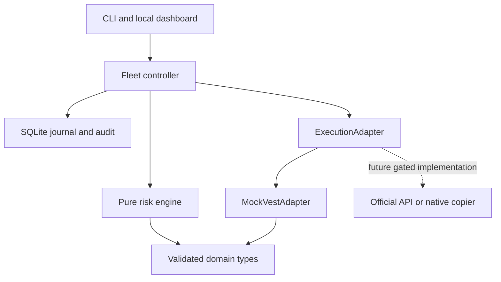

# Architecture

Status: initial implementation, simulation-only. Decision date: 2026-09-29.

The domain and risk engine contain no Vest transport knowledge. A `TradeIntent`
describes direction, market entry, stop/target distances, risk allocation and leverage.
The controller retrieves per-account state, calculates a preview, and independently
revalidates each child before dispatch through an `ExecutionAdapter`.

Node 24, TypeScript, pnpm, Zod, decimal.js, Vitest, ESLint and Prettier provide a
small reproducible toolchain. SQLite uses Node's built-in API. The first local dashboard
uses Node HTTP plus plain browser JavaScript/CSS, avoiding an extra frontend build step.
The user requested leverage/allocation controls after the CLI delivery. React/Vite remains
an optional later UI implementation, not a dependency for running the current dashboard.

## Component ownership

| Component       | Current responsibility                                                                  | Later extension                                                             |
| --------------- | --------------------------------------------------------------------------------------- | --------------------------------------------------------------------------- |
| Account manager | Validated account snapshots; adapter inventory, enable state, fixed floor               | Durable fleet metadata and explicit sync service                            |
| Risk engine     | Decimal formulas, all-in loss, size rounding, reserve, freshness, margin                | Verified instrument and account rule policies                               |
| Controller      | Selection, preview, sequential fan-out, idempotency, reconciliation, circuit halt       | Recovery UI, bounded concurrency only after rate-limit verification         |
| Adapter         | Simulation-only capability contract                                                     | Official supported transport or native copier                               |
| Simulator       | Independent accounts, unprotected entries, separate reduce-only exits, costs and breach | Deterministic event replay and liquidity model                              |
| Journal         | Durable master/child attempts and allowlisted audit events                              | Schema migrations, recovery reconciliation service                          |
| Dashboard       | Local simulation controls                                                               | Price, fleet table, master controls, per-account preview, prominent flatten |

## Major assumptions and decisions

1. Fixed $490 floors, Instant fees, and 95% withdrawal share are observations, not
   verified current rules. The share is an explicit withdrawal parameter.
2. Fixed-dollar and drawdown budget inputs represent all-in planned loss. Margin-percent
   inputs allocate min(balance, equity) as margin, multiplied by leverage for exposure. The original gross sizing formulas
   remain separate tested functions. No hidden leverage multiplier changes P&L.
3. The internal product is a linear synthetic `NDX`, one unit = $1/point. No external
   symbol, quantity step, contract multiplier or liquidation formula is certified.
4. All new entries require flat accounts. Same-direction additions and reversals are
   rejected; partial closes are supported by the mock. Opposite fleet positions are
   blocked across enabled accounts by the mandatory hedge guard; disabled accounts
   are ignored under the user's specified scope. Vest's exact policy remains unverified.
5. Daily-loss floor may be supplied, and the stricter floor wins. Automatic daily
   reset logic is deferred because Instant applicability and baseline are unresolved.
6. Sequential dispatch simplifies the initial safety model and allows revalidation
   between children. First unexpected failure halts further dispatch. This deliberately
   does not produce every possible error in a single ten-account run; independent
   scenarios test reject, timeout and ambiguous-after-fill responses.
7. Breach is permanent in a simulation run. Equity at or below the effective floor
   breaches and closes positions at the current simulated price plus adverse slippage.
8. The dashboard persists validated simulator snapshots in its session journal and restores them halted. CLI runs remain isolated. An exclusive local owner lock prevents concurrent use of the same dashboard store.
9. Circuit halts have no automatic reset. There is no live credential or execution mode
   flag that can turn this prototype into a funded-account trader.
10. Leverage is checked as a configurable ceiling and margin requirement; venue-specific
    liquidation, maintenance margin, funding schedules and server protective orders are M5 gates.

## Future adapter contract

Future implementations may be named `VestOfficialApiAdapter` and
`VestNativeCopierAdapter`. Both must provide verified account scoping, market metadata,
authoritative reconciliation, protection status, request identity and emergency close
semantics. A native copier may not support independent follower sizing: if so it cannot
claim compatibility with this controller's risk guarantees. Capability negotiation and
explicit refusal are preferable to silently weakening the risk model.

The simulation contract separates `placeOrder` (entry only) from
`placeProtectionOrder`, `getProtectionOrder`, `getOpenOrders` and `cancelOrder`.
Positions reference an entry ID and protection status; SL/TP records are independent.
The controller journals the unprotected interval, derives prices from the actual fill,
verifies both exits and only then continues fan-out. Post-entry uncertainty triggers
account cleanup and circuit halt. Simulator-owned sibling cancellation models OCO
behavior without claiming native venue support. See [execution model](execution-model.md).

Explicit leverage-change commands, live subscriptions, venue ID mapping and recovery
must be designed only when a supported implementation and its capabilities are verified.

## Local dashboard boundary

`apps/dashboard/server.ts` binds only to 127.0.0.1. Requests require the exact Host;
provided Origins must match. Mutations require a process-specific token and JSON body,
with Zod validation and a 16 KiB body limit. No CORS, no live transport, no remote login.
Static files are allowlisted and served with a restrictive content security policy.

Mutations are serialized or rejected while busy. Flatten latches the controller halt
immediately, waits for the active bounded operation, then closes and reconciles accounts.
Preview refresh updates the **synthetic** quote; no real market freshness is implied.
Previews expire after the configured five seconds and are invalidated by UI changes.
The client preserves request identity during execution and blocks new entries on lost
responses. Session IDs prevent old browser requests from trading after a simulator reset.

Dashboard sessions persist accounts, quote, entry/protection books and request fingerprints
in SQLite. `SimulationStore` selects the active session through an atomic manifest and
holds an exclusive owner lock. Restart restores the session, latches the halt and
reconciles; an explicit new simulation rotates the session while preserving the old
journal. Re-arm remains unimplemented. Stale locks require deliberate operator recovery.

The controller owns one reusable reconciliation operation. Startup, the serialized
one-second service loop and the Reconcile action call it. It checks authoritative
simulator books, cancels verified orphan protection, detects divergence and cleans
unsafe exposure. It never clears the circuit. `/api/health` and the dashboard expose
book freshness, health and process-local stage metrics. The existing audit remains
the durable event record. See [reliability audit](reliability-audit.md).

## Fleet exposure policy

The risk engine owns a pure, reusable fleet-exposure rule pipeline. Its mandatory
same-market rule is shared by controller preview, immediate child pre-trade validation,
and MockVestAdapter submission validation. `CROSS_ACCOUNT_HEDGE_GUARD = ENABLED` has
no disable switch. Only enabled accounts contribute exposure, even if unselected.
The prior prototype's treatment of disabled opposite exposure is superseded by this
explicit user requirement. Flatten and close operations do not run entry hedge rules.

Exposure-rule inputs accept generic market labels as a narrow read-only view, allowing
future correlated-market rules without changing sizing or execution interfaces.
Current executable domain schemas remain single-market NDX. Additional rules are additive;
no correlated blocking policy is shipped. A future adapter must scope the fleet to funded
accounts and provide authoritative, fresh positions plus unresolved-order reconciliation.
A local rule cannot prevent a separate manual trader or service from changing positions
between checks; no atomic cross-account venue guarantee is claimed.
