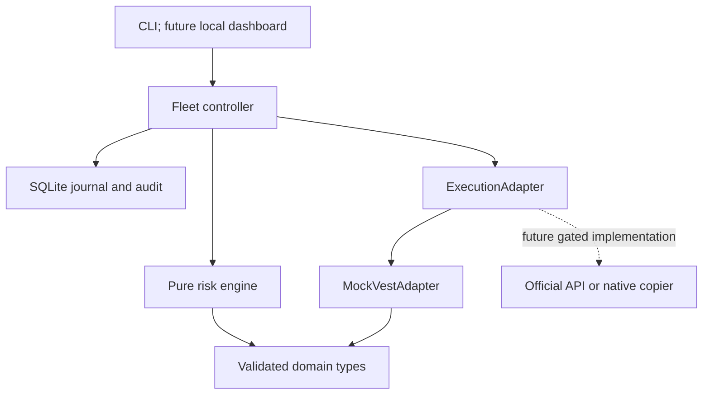

# Architecture

Status: initial implementation, simulation-only. Decision date: 2026-09-29.

The domain and risk engine contain no Vest transport knowledge. A `TradeIntent`
describes direction, market entry, stop/target distances, risk allocation and leverage.
The controller retrieves per-account state, calculates a preview, and independently
revalidates each child before dispatch through an `ExecutionAdapter`.

Node 24, TypeScript, pnpm, Zod, decimal.js, Vitest, ESLint and Prettier provide a
small reproducible toolchain. SQLite uses Node's built-in API. A future local service
will use Fastify, with React/Vite for the dashboard. No HTTP server or dashboard is
needed for this first preview-and-simulation deliverable.

## Component ownership

| Component       | Current responsibility                                                                 | Later extension                                                             |
| --------------- | -------------------------------------------------------------------------------------- | --------------------------------------------------------------------------- |
| Account manager | Validated account snapshots; adapter inventory, enable state, fixed floor              | Durable fleet metadata and explicit sync service                            |
| Risk engine     | Decimal formulas, all-in loss, size rounding, reserve, freshness, margin               | Verified instrument and account rule policies                               |
| Controller      | Selection, preview, sequential fan-out, idempotency, reconciliation, circuit halt      | Recovery UI, bounded concurrency only after rate-limit verification         |
| Adapter         | Simulation-only capability contract                                                    | Official supported transport or native copier                               |
| Simulator       | Independent accounts, protected fills, costs, funding scenarios, withdrawal and breach | Deterministic event replay, persistent simulator snapshots, liquidity model |
| Journal         | Durable master/child attempts and allowlisted audit events                             | Schema migrations, recovery reconciliation service                          |
| Dashboard       | Deferred                                                                               | Price, fleet table, master controls, per-account preview, prominent flatten |

## Major assumptions and decisions

1. Fixed $490 floors, Instant fees, and 95% withdrawal share are observations, not
   verified current rules. The share is an explicit withdrawal parameter.
2. Budget inputs represent all-in planned loss. The original gross sizing formulas
   remain separate tested functions. No hidden leverage multiplier changes P&L.
3. The internal product is a linear synthetic `NDX`, one unit = $1/point. No external
   symbol, quantity step, contract multiplier or liquidation formula is certified.
4. All new entries require flat accounts. Same-direction additions and reversals are
   rejected; partial closes are supported by the mock. Opposite fleet positions are
   blocked conservatively pending verification of Vest's hedging rules.
5. Daily-loss floor may be supplied, and the stricter floor wins. Automatic daily
   reset logic is deferred because Instant applicability and baseline are unresolved.
6. Sequential dispatch simplifies the initial safety model and allows revalidation
   between children. First unexpected failure halts further dispatch. This deliberately
   does not produce every possible error in a single ten-account run; independent
   scenarios test reject, timeout and ambiguous-after-fill responses.
7. Breach is permanent in a simulation run. Equity at or below the effective floor
   breaches and closes positions at the current simulated price plus adverse slippage.
8. Simulator state is in memory; audit and deduplication records are durable. Restarting
   the adapter is a new simulation, not resuming the same account reality.
9. Circuit halts have no automatic reset. There is no live credential or execution mode
   flag that can turn this prototype into a funded-account trader.
10. Leverage is checked as a configurable ceiling and margin requirement; venue-specific
    liquidation, maintenance margin, funding schedules and server protective orders are M5 gates.

## Future adapter contract

Future implementations may be named `VestOfficialApiAdapter` and
`VestNativeCopierAdapter`. Both must provide verified account scoping, market metadata,
authoritative reconciliation, protection status, request identity and emergency close
semantics. A native copier may not support independent follower sizing: if so it cannot
claim compatibility with this controller's risk guarantees. Capability negotiation and
explicit refusal are preferable to silently weakening the risk model.

Methods for cancellation, explicit leverage changes and subscriptions should be added
when a supported implementation needs them. Current market entries are immediately
filled/rejected/unknown; fake no-op cancellation methods would imply safety that is absent.
