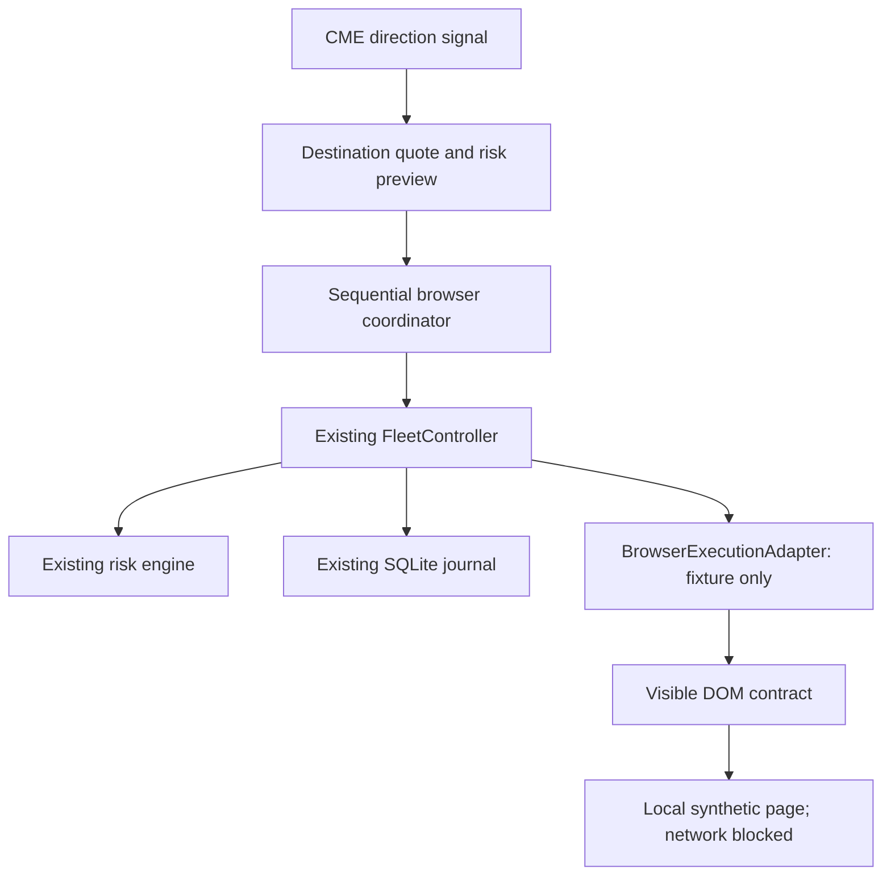

# Browser execution investigation and fixture architecture

Immediate priority (2026-10-01): [audit fixture-to-real execution gaps](vest-execution-gap-audit.md),
validate the offline partial-evidence contracts, then inspect
an authorized session using [the read-only runbook](vest-read-only-observation.md).
Visual polish/installers are paused. `observations.ts` and `readonly.ts` are offline-only,
have no trading methods and are not connected to the execution controller or Vest.

Decision/evidence date: 2026-09-29 (America/Los_Angeles).
Reviewed baseline: `0b81f263fff2758103023a1f854f63a8df869af4`.

## Decision

Funded API execution is removed from the plan for this ten-Instant-account fleet.
The current [official FAQ](https://next.vestmarkets.com/faq), under the funded API
question, explicitly excludes Evaluation, Live Funded and Instant accounts. This
was read in Work Browser, not inferred from the standard exchange API.

A browser workflow is an investigation, **not an authorized substitute for the API**.
Automated execution and commercial scope remain unresolved. The separate manual
launcher opens official Vest with owner read-only authorization; the fixture adapter
has no production execution transport, account credentials, real selectors or remote
browser attachment, or live mode. The new adapter operates only against original local
DOM fixtures. The ordinary dashboard continues to use `MockVestAdapter`.

## Policy and access blockers

- Automated same-owner copying and concurrent-session terms remain unverified.
  No blanket automation ban was found in the public terms reviewed on 2026-10-01;
  owner-authorized manual read-only inspection now uses [the launcher](vest-read-only-observation.md).
- The public prop terms, updated September 28, 2026, contain a single-Account provision
  in section 2. The FAQ permits ten funded accounts including Instant. A login versus
  funded-subaccount distinction might explain this, but that is an inference requiring
  confirmation, not a reason to dismiss either source.
- The standard Site terms and prop terms describe different products and jurisdiction
  lists. Confirm the applicable agreement for the funded UI; do not route to the
  standard exchange as a workaround.
- Work Browser initially had only a blank tab. Public pages showed Log In/Sign Up;
  no authenticated fleet was available. The owner subsequently authorized personal
  manual read-only inspection on 2026-10-01. Actual account selection and cross-tab
  behavior remain unobserved.
- No private endpoints, tokens, cookies, request interception, internal application
  stores, bundled source analysis or Capital API reverse engineering were used.

Sources: [FAQ](https://next.vestmarkets.com/faq),
[prop terms](https://next.vestmarkets.com/prop-terms-of-service),
[general Site terms](https://next.vestmarkets.com/terms-of-service).
The browser rendered these public pages; web-search retrieval failed. Do not describe
that retrieval failure as a site outage or bot block.

## Phase 1: what is actually known

| Requested inspection                            | Result / required evidence                                                                                                                                                                                  |
| ----------------------------------------------- | ----------------------------------------------------------------------------------------------------------------------------------------------------------------------------------------------------------- |
| Account selection mechanism                     | Unverified: dropdown/page/wallet/URL scoping cannot be determined from a signed-out page.                                                                                                                   |
| Cross-tab selection effects                     | Untested. Ordinary tabs are not treated as isolated.                                                                                                                                                        |
| Multiple accounts simultaneously open           | Unverified technical behavior and permission.                                                                                                                                                               |
| Multiple browser sessions                       | Unverified; manual inspection uses one session and page.                                                                                                                                                    |
| MARKET side, size, leverage and submit controls | Actual funded selectors unobserved. No selectors guessed.                                                                                                                                                   |
| Filled quantity/price, status and errors        | Actual visible evidence and precision unobserved. Toasts alone are insufficient.                                                                                                                            |
| Post-fill protection                            | FAQ describes Adjust SL/TP on an open position in Portfolio or the market page; smaller screens may need horizontal scrolling. Market/limit choices are described. Funded behavior still needs observation. |
| With-entry TP/SL                                | Unverified; not used by our lifecycle.                                                                                                                                                                      |
| Open orders/cancellation                        | FAQ describes an Open Orders tab in Portfolio and per-market views, with individual cancellation.                                                                                                           |
| Reduce-only and sibling/OCO behavior            | Unverified. The existence of Adjust SL/TP does not prove either guarantee.                                                                                                                                  |
| Close/flatten and final cancellation proof      | Unobserved. Require exact account identity, a completed exit, flat position, and no remaining active protection or unresolved entry.                                                                        |

For owner-authorized personal read-only inspection, use the dedicated manual browser and session
for read-only observations. Record redacted conceptual screenshots and accessible control
names, scoped to account and market. Do not save authentication screens, account tokens,
cookies, complete account pages or unredacted personal data in git. Real selectors must
come from inspected visible UI; fixture selectors are deliberately labeled synthetic.

## API-oriented work removed or deferred

| Earlier task                                                      | Revised disposition                                                                                                                      |
| ----------------------------------------------------------------- | ---------------------------------------------------------------------------------------------------------------------------------------- |
| Build `VestOfficialApiAdapter` for the Instant fleet              | Removed from the active plan; current FAQ rules it out.                                                                                  |
| Discover Capital auth, tokens, account endpoints or signing       | Removed. Do not inspect/replay private requests or reuse browser credentials as an API.                                                  |
| Wait for promised funded API access                               | Removed as a delivery dependency. Revisit only if official policy changes.                                                               |
| Funded API WebSocket, nonce and numeric rate-limit implementation | Out of scope for this UI investigation. Browser action pacing, session loss and stale visible state remain separate future requirements. |
| Native copier                                                     | Retained as preferred conditional option; release, permissions and capabilities remain unverified.                                       |
| Account metadata, identity, precision, protection, reconciliation | Retained as mandatory evidence gates; a browser interface does not waive them.                                                           |

## Recommended account workflow

| Approach                                    | Decision                                                                                                                                                                      |
| ------------------------------------------- | ----------------------------------------------------------------------------------------------------------------------------------------------------------------------------- |
| One session, one page, sequential switching | Preferred candidate. One serialized DOM owner; select and prove account, enter, prove fill, protect, prove both, then next account. Safety remains conditional on inspection. |
| Ten ordinary tabs                           | Rejected as an isolation assumption. Shared session/account selection may change another tab. No parallel entries.                                                            |
| Isolated browser contexts                   | Future investigation only after explicit permission and evidence of account isolation. Separate local storage alone does not prove server-side session isolation.             |
| Native copier                               | Prefer an official supported copier if it satisfies independent sizing, per-account fills, protection, reconciliation and emergency controls. Availability unverified.        |

The single page has an immutable allowlist of synthetic account IDs and labels. Each
account operation receives an immutable binding to its expected ID, label and context;
a single serialized queue owns selection and action. This is not a claim that one page
is permanently bound to one account while simultaneously switching among ten. Future
isolated workers must each have one immutable account binding and their own context.

## Architecture and ownership

The controller remains the **only owner** of trade state, protection-price calculation,
hedge checks, risk calculations and child fan-out. It obtains the actual destination
fill through the adapter; `protectionPrices()` and `assessFilledRisk()` remain unchanged.
The adapter translates visible evidence and actions, rather than introducing a second
risk engine. Account ID, label and context must match before acting and after forms
are prepared. Entry also requires the account snapshot to remain unchanged during form entry. A mismatch halts, and cleanup is attempted only in a positively verified
account context. It is unsafe to flatten whatever account happens to be visible.

The existing trade states remain:
PREVIEWED → ENTRY_SUBMITTING → ENTRY_FILLED_UNPROTECTED → PROTECTION_SUBMITTING
→ PROTECTED. UNKNOWN/HALTED and cleanup remain failure paths. The temporary unprotected
state is unsafe. A raw fill acknowledgment is never a protected-trade result.

The separate browser session states are DISCONNECTED, READY, SELECTING_ACCOUNT,
VERIFYING_ACCOUNT, SUBMITTING, UNCERTAIN, RECOVERY_REQUIRED and CLOSED. These describe
transport/context health, not an alternative execution state machine.

CME data can decide direction. Every destination uses its **own actual fill** for SL/TP.
For a LONG fill of 30,450 with 25-point SL and 50-point TP, prices are 30,425 and 30,500.
This does not imply CME and Vest prices or contract multipliers are interchangeable.

## Evidence contract: blockers a real UI must satisfy

| Outcome             | Minimum visible proof                                                                                                                                                      |
| ------------------- | -------------------------------------------------------------------------------------------------------------------------------------------------------------------------- |
| Entry filled        | Exact account and market; unique correlated order/fill identity; completed or terminal-partial status; actual quantity and weighted average fill; fees; matching position. |
| SL active           | Exact position/account, exit side, active status, trigger basis and price, protected quantity, unique order identity, and documented reduce-only semantics.                |
| TP active           | Same independent proof as SL. One generic success message cannot prove both.                                                                                               |
| Position closed     | Verified final exit and flat position; no unresolved entry capable of filling later.                                                                                       |
| Protection canceled | Exact order has final canceled/filled status plus absence from active book. Mere disappearance may be pagination or stale UI.                                              |

The synthetic fixture deliberately exposes complete structured state in a **visible**
book panel and a visible command form. It also supports deterministic request IDs. These
are testing affordances, not claims about Vest. A real UI might not expose client IDs,
full decimal precision, fees, quote timestamps, complete inventory, terminal remainders,
reduction semantics, order history or all required account risk fields. Missing evidence
is a capability blocker; never fabricate IDs, timestamps or zeros to satisfy the schema.

The simulator currently supplies sibling/OCO behavior behind the fixture. No live
browser OCO monitor is implemented. If Vest lacks native OCO, a permitted monitoring/
cancellation workflow and race tests are required; reduce-only must still prevent reversal.
The future bridge must also verify market-versus-limit protection controls explicitly.
A stop-limit order must not silently substitute for the modeled stop exit.

A DOM pre-check is not atomic with server-side account selection. Another tab, human,
or delayed UI update could still change context between observation and acceptance.
Exclusive operator/browser ownership and account-scoped controls must be validated.
If safe identity correlation cannot be demonstrated, do not enable browser execution.

## Sequential drift, timing and partial fleet policy

The coordinator passes a configurable `maxFleetPriceDriftPoints` (constructor option;
fixture only) to the adapter. The baseline is the **destination quote in the preview**.
The adapter checks absolute quote drift before submission and again after form entry.
Existing controller freshness, preview age and `maxPriceMovePoints` still apply; the
stricter effective bound wins. No production limits were lengthened for browser speed.

A market fill cannot be predicted exactly before clicking. If the actual fill exceeds
this fleet drift tolerance but passes existing per-account risk/slippage checks, protect
that child and stop subsequent entries. If actual risk itself fails, flatten that child
and halt through the existing controller. Already protected earlier children remain
explicit and protected. This is sequential execution, not simultaneous or atomic copying.

Metrics reuse allowlisted audit `status` and `latency` fields for account switch/verification,
submit return and fleet duration. Existing fill and protection latency remain available;
fill-to-protection is measured from authoritative confirmation, not a hidden venue timestamp.
The result includes signed first-to-last destination fill drift, and local counts for
switches, drift rejections and timeouts. These are fixture measurements, not promises of
real Vest execution latency. A signal-feed timestamp/basis check remains future work.

## Retry, timeout and restart rules

- Every entry, protection, cancellation and flatten attempt is durably claimed in the
  existing journal's `browser_actions` table **before** its possible UI side effect.
  The record stores ID, hash of the intended action, account and state, never raw DOM or
  authentication material. Same ID/different action conflicts; same ID never clicks twice.
- Duplicate actions may read current evidence; they never assume a prior click succeeded.
  Master trade retries continue to use the existing journal replay path.
- There are no automated write retries. Read operations are bounded and may be performed
  again by explicit authoritative reconciliation. Missing, stale, duplicate or ambiguous
  rows fail closed. No fuzzy text/coordinate fallback for trading controls.
- A timeout quarantines the fixture page. A click might already have reached its target;
  closing a browser cannot retract an accepted entry. If the page is unavailable, cleanup
  is attempted but remains UNKNOWN. Operator intervention is required; never claim that
  browser-based emergency flatten is available during a browser/venue outage.
- A new adapter over a journal with browser attempts starts RECOVERY_REQUIRED. Entries
  remain blocked, reads and positively identified cleanup are allowed, and reconciliation
  never re-arms it. Browser actions do not store session state; users must re-establish
  access through an officially permitted login flow in a future implementation.
- The real controller continues to own pending requests and unresolved exposure. No
  browser restart is allowed to manufacture a new empty fleet or resend pending entries.
- Protection replacement remains unsupported. Repeated cancel/flatten uses known state
  and deterministic IDs; continuing entry/protection partial fills remain unsupported.

## Files and safe implementation delivered

- `packages/browser-execution/src/dom.ts`: identity, visible evidence and DOM port.
- `packages/browser-execution/src/adapter.ts`: fixture-only adapter, serialized account
  operations, evidence checks, durable click claims, bounded waits and drift checks.
- `packages/browser-execution/src/coordinator.ts`: thin wrapper around existing fan-out.
- `packages/execution/src/journal.ts`: additive browser-attempt records.
- `tests/fixtures/browser-page.ts`: original synthetic page powered by the mock simulator;
  isolated ephemeral Chromium context, all network requests blocked.
- `tests/browser-execution.test.ts`: actual Playwright interactions with local fixtures.
- Fact register, architecture, roadmap and development instructions: API direction removed.

Playwright is a pinned development dependency; ordinary dashboard operation does not
launch a browser or depend on installed Chromium. Install test Chromium with
`pnpm exec playwright install chromium`, then run `pnpm check`. On supported Linux CI,
`pnpm exec playwright install --with-deps chromium` also installs required system libraries.
An existing local test binary may be supplied via `BROWSER_TEST_EXECUTABLE`.

## Before a supervised one-account trial

1. Review applicable automated-copy/session terms, resolve agreement/account scope and
   authorize the exact execution trial separately. Owner read-only consent is already
   recorded; it is not a claim of venue or commercial approval.
2. Read-only inspect an authorized funded session; verify account selection and cross-tab
   behavior, exact market/size/leverage units, quotes, order history and error surfaces.
3. Prove fill correlation, terminal partial handling, reduce-only exits, trigger basis,
   precision, OCO/orphan cleanup and emergency closing through permitted visible UI.
4. Complete browser-loss, restart, late-fill, stale UI, cancel race and operator recovery
   acceptance tests. Define independent manual recovery when automation is unavailable.
5. Measure sequential latency and drift in an approved paper/test environment if available.
   Choose operational preview/freshness deadlines from evidence, not arbitrary relaxation.
6. Present the required pre-integration review. Any one-account funded trial requires
   separate authorization, supervised minimal exposure and a confirmed rollback procedure.
7. Only after sequential success consider 2 contexts, then 3–5, then 10. Permission,
   isolation and account/position/fill/SL/TP checks must hold independently in each context.

## Questions to send to Vest (draft only; not sent)

Does Vest explicitly permit a local tool using visible browser controls to submit
same-direction trades and manage post-fill SL/TP across my own ten Instant accounts?
Does the single-Account clause refer to the login while the ten-account FAQ refers to
funded subaccounts? Are concurrent sessions or isolated browser contexts allowed, and
does selecting a funded account affect other tabs/sessions? Is there an officially
supported native copier? What documented guarantees apply to reduce-only protection,
OCO cancellation, order/fill identifiers and ambiguous submissions?
