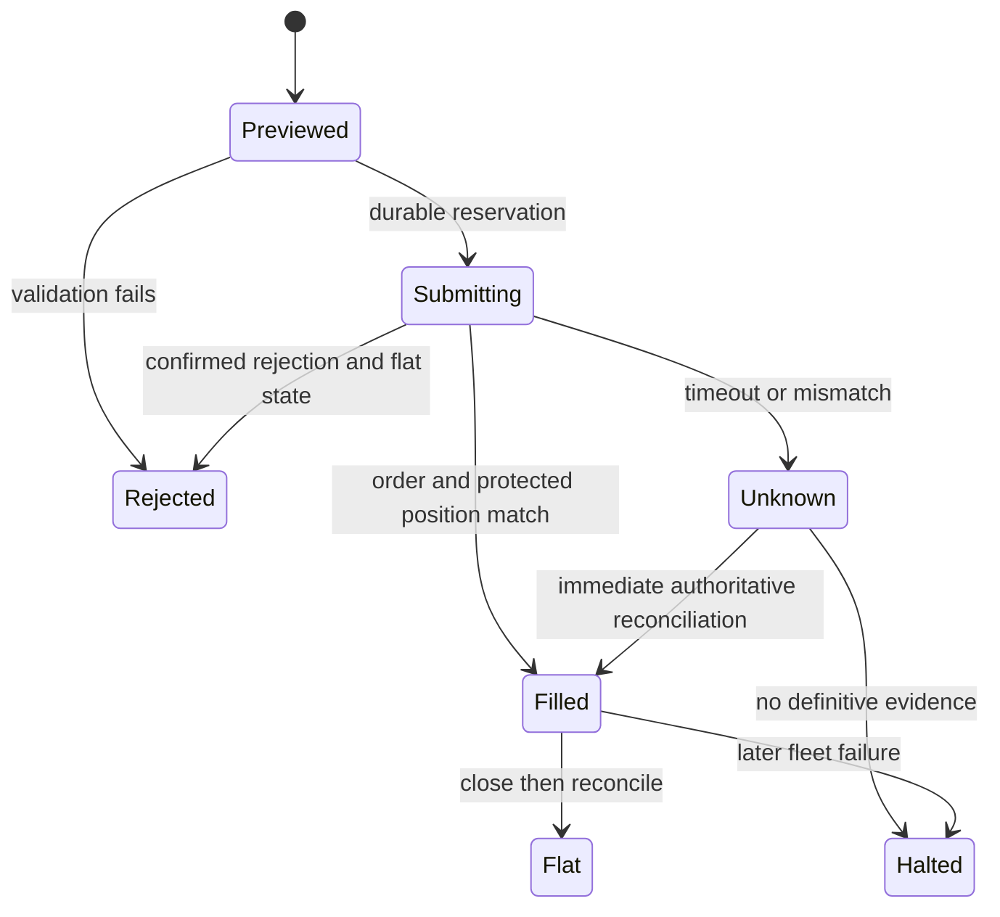

# Execution and reliability

## Identity and preview

The caller supplies a unique master trade ID for each new intention to trade.
Children derive deterministic SHA-256 IDs from master ID and account ID. A preview
hash binds validated intent, selected account snapshots, quotes and risk outputs.
The controller executes only its stored preview, not caller-edited order data.
Exact retries return historical outcomes. They are not a statement of current exposure;
read current account state after any close or subsequent market event.

## State model

SQLite persists the submitting state as an unknown child result before the adapter
call. An unfinished master or unknown child opens the circuit on controller startup.
The initial prototype has no automatic recovery/reset operation: preserve the journal,
inspect the mock/venue truth, and implement a reviewed recovery workflow before M5.

## Dispatch policy

Dispatch is sequential. Each account is re-read, re-sized and checked for revision,
balance, equity, floor, enabled state, freshness, existing position and opposing fleet
exposure. Preview expiry and price drift are checked again. A re-sized quantity may
not exceed the preview quantity. Excess movement or changed state requires a new preview.

An account rejected at preview (for example disabled or insufficient buffer) is skipped.
An unexpected rejection/uncertain result after a previously approved preview opens
the circuit and stops further dispatch. Already filled accounts remain open with the
mock's atomically installed stops/targets until a trigger or explicit flatten.

All ten results remain visible; never silently equate partial execution with fleet success.
Partial fill acknowledgements have no success path yet and must reconcile or remain
unknown. No automatic compensating trades are attempted.

## Reconciliation

After dispatch, query the adapter order ledger and account positions. Accept a fill
only when request/account identity, direction, symbol, quantity, stop and target match
the intended child. An ambiguous acknowledgement can resolve if that evidence is present.
Otherwise retain unknown and halt. Acknowledgement alone is insufficient.

After emergency closes, query account state again. Flat positions plus no unresolved
submissions are required for a `FLAT` report. A failure on one account does not prevent
attempting the remaining accounts. Account disable state never prevents flatten.

## Timeouts, concurrency and emergency operation

A timeout bounds waiting; it **does not cancel the underlying request**. Late completion
is possible. There is no automatic retry of entry, close or leverage commands. Unresolved
entry requests remain a blocker even if the current position snapshot is empty.

One controller owns one fleet. A busy guard serializes entry operations. Emergency
flatten first latches the circuit, so later children cannot dispatch. If a batch is
currently active, it returns `EXECUTION_IN_PROGRESS_RETRY_FLATTEN`; call flatten again
after that bounded operation completes. The local dashboard supplies this coordination:
it calls `requestHalt()` immediately, waits for its in-progress operation, then runs
flatten and reports each account outcome. No new entry is accepted after the request.
Direct non-dashboard callers must still handle the busy/retry result.

No promise of globally exactly-once trading is possible from client IDs alone. A live
adapter requires documented server deduplication or authoritative lookup plus safe
recovery semantics. Multiple service processes, manual venue trades, disconnect recovery,
subscription gaps and durable simulator restart are outside this initial release.

## Audit

SQLite stores timestamp, master/child/account IDs, symbol, direction, requested and
filled size, prices/protection, fees, status, fixed error code, adapter and latency.
Simulator mutation events also record price updates, closes, funding, withdrawals,
account toggles and injected failures when connected to the CLI audit sink.

Unknown fields are stripped by an allowlist. Callers never pass raw exceptions, headers,
request dumps or credentials into allowed strings. Runtime databases and logs are ignored
by git. The prototype does not collect passwords, keys, cookies or tokens.

SQLite is durable local storage, not a tamper-proof/compliance audit system. Disk failure
can stop execution; the controller must not proceed after journal-write failure.
