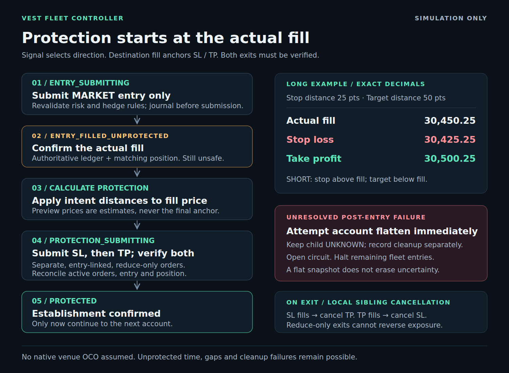
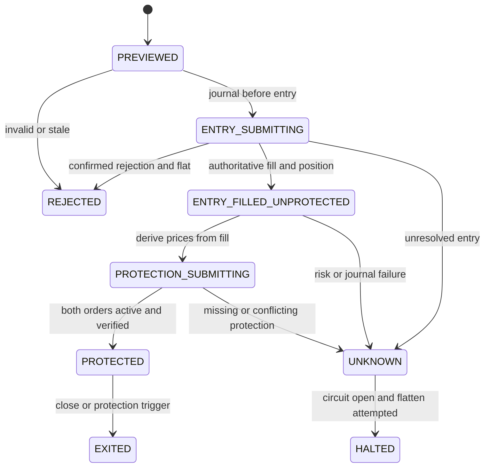

# Execution and reliability

Simulation-only design, updated 2026-09-29. No live Vest transport or native OCO
capability is assumed.

## Identity and preview

The caller supplies a unique master trade ID for each new intention to trade.
Children derive deterministic SHA-256 IDs from master ID and account ID; each SL/TP
request derives its ID from the entry request ID and protection type. A preview hash
binds validated intent, selected account snapshots, quotes and risk outputs. The
controller executes only its stored preview, not caller-edited order data.

Exact retries return historical outcomes without sending entries or protection again.
A replayed `PROTECTED` outcome describes establishment, not current exposure. Read the
current account and protection book after a close or market event. Simulator exits emit
`EXITED` audit events; they do not rewrite the historical master result.

## Entry and protection flow

SIGNAL → MARKET ENTRY → ACTUAL FILL → CALCULATE PROTECTION → SUBMIT REDUCE-ONLY SL/TP
→ VERIFY PROTECTION → PROTECTED.

A CME or other signal source may determine LONG/SHORT. Final SL/TP prices always use
the **actual destination fill**, never a CME price or the pre-trade quote. Signal
feed integration itself is not implemented.

`ENTRY_FILLED_UNPROTECTED` is explicitly unsafe, even though the market entry succeeded.
`UNKNOWN → HALTED` describes the controller action: the affected child's result stays
`UNKNOWN`, and later children are `HALTED`. Only a `PROTECTED` child has controller
`status: FILLED`. The adapter's raw entry `FILLED` status is not establishment success.

Each child performs these steps sequentially:

1. Re-read account, quote and enabled fleet; revalidate risk, hedge rules and preview.
2. Persist `ENTRY_SUBMITTING`; submit the MARKET entry once, without protection.
3. Query the authoritative entry ledger and position. Verify identity, side, symbol,
   leverage, full quantity and actual fill price. Acknowledgement alone is insufficient.
4. Persist `ENTRY_FILLED_UNPROTECTED`; check fill slippage and entry costs against the
   preview envelope. Calculate SL/TP from actual fill and authoritative intent distances.
5. Persist `PROTECTION_SUBMITTING` and the deterministic SL request; submit reduce-only
   STOP_LOSS, then verify it by authoritative lookup.
6. Persist and submit reduce-only TAKE_PROFIT, then verify it the same way.
7. Re-read both orders, the open-order book, entry ledger and position. Require exactly
   the intended active pair, matching identity, type, side, quantity and decimal trigger
   prices, plus an `ACTIVE` position protection status.
8. Persist `PROTECTED`; only then proceed to the next account.

The simulation contract uses client request IDs as protection order IDs. A future
adapter must provide documented request-to-venue-ID lookup before changing this contract.
Full entry fills are required; partial fills have no establishment success path.

## Dispatch and failure policy

Each child checks revision, balance, equity, floor, enabled state, freshness, existing
position and enabled-fleet opposing exposure. Preview expiry and price drift are
checked again. Re-sized quantity cannot exceed the preview quantity.

Pre-rejected accounts are skipped. An unexpected rejection after approval opens the
circuit. Any unresolved step after entry submission also opens the circuit and immediately
attempts account flatten, including cancellation of any partial protection. Both SL and
TP failures use this policy. The child remains `UNKNOWN`, with separate
`cleanupStatus: FLAT | UNKNOWN`; cleanup success does not authorize replay or re-arm.
Remaining accounts receive no entry. Earlier established accounts keep their protection.

A missing/invalid acknowledgement may resolve through exact authoritative lookup. No
blind entry or protection resubmission occurs. If SL fires before TP can be established,
the controller cannot verify a protected open position and fails closed, even if flat.

## Protection and sibling cancellation

Positions carry `entryRequestId` and `protectionStatus` (`NONE`, `SUBMITTING`, `ACTIVE`,
`FAILED`), not mandatory stop/target fields. Protection orders are separate records
linked to that exact entry, with type, trigger price, quantity, reduce-only flag and
`ACTIVE | FILLED | CANCELED | REJECTED` status.

The simulator evaluates ACTIVE orders on price updates. TP fill cancels SL; SL fill
cancels TP. Full close, breach close and emergency flatten also cancel remaining exits.
An order must match the current entry identity and side, and can execute at most the
remaining quantity. A stale order cannot reverse exposure or close a newer entry.
After a partial manual close, exit quantity is capped to the remaining position.
Duplicate request IDs return the current existing order; changed payloads conflict;
terminal orders are never reactivated by retry.

This sibling behavior is implemented locally inside the simulator, **not proof of
venue-native OCO**. Future live support requires verified reduce-only semantics,
trigger/tick rules, cancellation races, subscriptions and restart recovery.

## Timeouts, concurrency and emergency operation

Every adapter call has a deadline. Timeout bounds waiting; it **does not cancel the
underlying request**. Cleanup is bounded too and may fail. Late effects are why unknown
children remain unresolved even when a cleanup snapshot looks flat. In the simulator,
a delayed protection call cannot attach to a closed or different entry. No client-side
sequence guarantees zero unprotected time or bounded losses across gaps/outages.

One controller owns one fleet. A busy guard serializes entry operations. Emergency
flatten first latches the circuit. If a batch is active, direct callers receive
`EXECUTION_IN_PROGRESS_RETRY_FLATTEN` and must call again after the operation finishes.
The dashboard calls `requestHalt()`, waits for its active bounded operation, then flattens.
Flatten includes disabled accounts, bypasses entry hedge rules, and attempts remaining
accounts if one fails. Reporting `FLAT` requires no position, no active protection and
no unresolved journal submission; an empty position snapshot alone is insufficient.

SQLite stores states and protection request intent before side effects. An unfinished
master or unknown child opens the circuit on restart. Legacy child results lacking
execution states also halt; replay raises `LEGACY_RESULT_REQUIRES_RECONCILIATION`.
Preserve old journals for inspection; no automatic migration can certify old protection.
There is no automatic reset/re-arm or persistent simulator restore. Multiple processes,
manual venue trades and disconnect recovery remain outside this prototype.

## Audit

SQLite stores timestamps, master/child/account IDs, entry linkage, protection IDs/type,
trigger prices, reduce-only flag, quantity, fill, fees, state, fixed error code, adapter
and latency. Simulator events include protection activation/cancellation, exits, price,
funding, withdrawals and account changes. Journal failure stops dispatch; post-entry
failure still attempts cleanup even if recording the halt fails.

Unknown fields are stripped by an allowlist. Never pass raw exceptions, headers, request
dumps or credentials into allowed strings. Runtime databases/logs are git-ignored.
SQLite is durable local storage, not a tamper-proof compliance audit system.

## Mandatory enabled-fleet exposure check

`CROSS_ACCOUNT_HEDGE_GUARD = ENABLED` remains mandatory in preview, before each child
and in mock submission. It scans every enabled account, even if unselected; disabled
exposure is ignored as specified. A pre-existing conflict blocks the fleet before any
entry; a conflict introduced during fan-out halts later children. Diagnostics identify
conflicting accounts with `CROSS_ACCOUNT_HEDGE_GUARD`. Flatten/close bypass this rule.
Correlated-market rules remain additive extension points with no active blocking policy.
