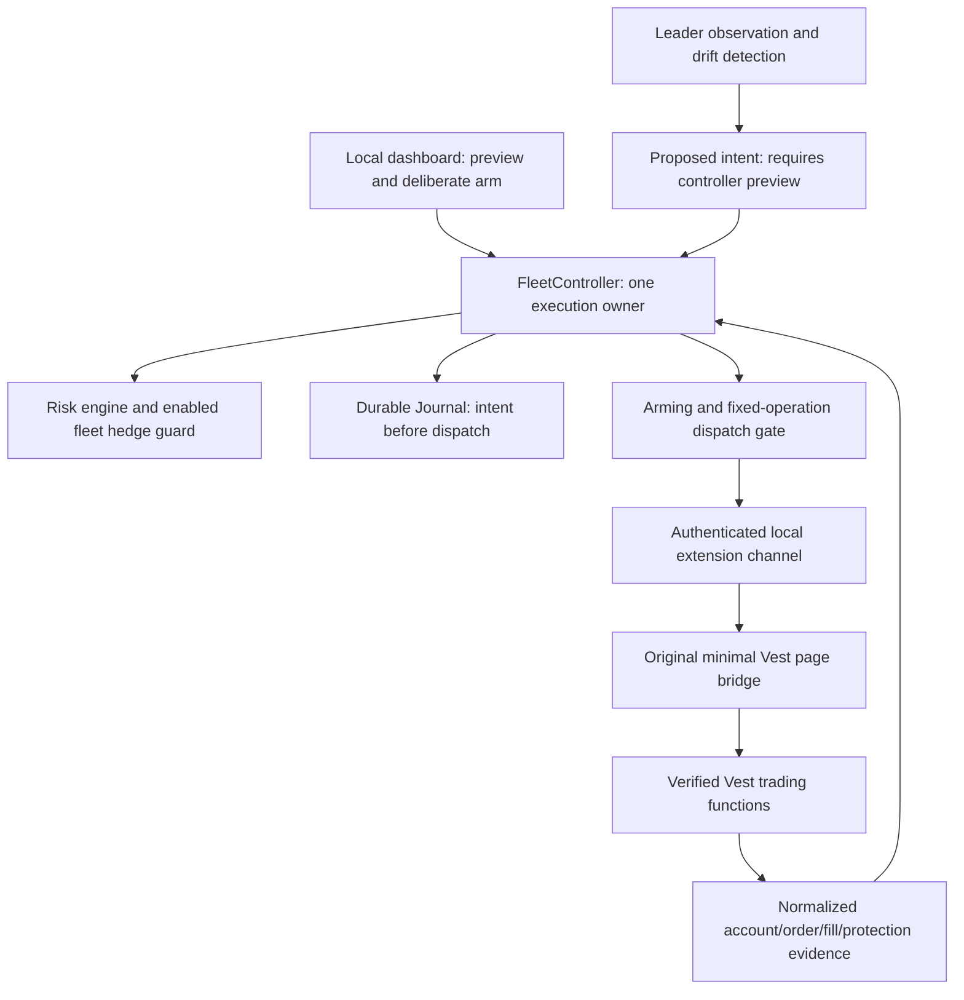

# Security-first Vest adoption audit and implementation plan

Audit date: 2026-10-05. Repository: `Mahdi451/vest-fleet-controller`.
Owner decision: retain this repository and its risk architecture; independently
implement the useful Better Vest workflow. Live funded trading remains **NO-GO**.
This document takes priority over earlier transport, remote-access, concurrency,
automatic-resume and UI plans where they conflict with the owner's threat model.

Implementation progress is recorded in [the local containment checkpoint](security-containment.md).
The findings below describe the audit-time baseline; payout removal and inert build
boundaries are subsequent work, not evidence of live transport or browser isolation.

Success means a reviewed local build with enforced capability/network boundaries,
restart-locked arming, sequential protected execution, durable uncertainty recovery,
and evidence for every release gate below. Passing fixture tests alone is not success
for live execution. This milestone delivers the audit and plan, not those boundaries.

## 1. Current architecture assessment

The dashboard constructs `MockVestAdapter`, `FleetController` and a SQLite `Journal`.
The controller accepts only `SIMULATION` adapters. `LIVE_VEST_SEND` is a constant
false and `sendCompanionCommand()` always throws. There is no production extension,
authenticated production bridge, live arming implementation, or live dashboard adapter.

The original offline bridge serializes strict synthetic operations and correlates
session/message/account identities. It uses durable action claims and quarantines
ambiguous responses. Its port is an in-memory trust assumption, not a secure browser
channel. Account and quote timestamps are separate from local message capture time.

Browser research has two other paths: a fixture DOM adapter/coordinator and a
single-account DOM executor with real Playwright click methods. The latter is used
only by tests today, but its exported functions can perform trades if handed an
authenticated page. The dashboard's false send flag does not guard those functions.
The manual observer launches a headed persistent browser for sign-in; it has profile
locks and navigation/lifecycle checks, but no comprehensive network containment.
It must not be launched under the owner's current no-window/no-chart constraint.

The controller already sizes independently per account, revalidates between sequential
children, checks enabled fleet exposure, persists before entry, confirms fills and
protection, and halts later accounts on unexpected failure. Its existing state names
include `ENTRY_FILLED_UNPROTECTED`, `PROTECTED` and `UNKNOWN`; they are not yet the
complete account/ticket/verified stages requested for production.

## 2. Components to retain

- `packages/core/src/index.ts`: validated domain types and Decimal arithmetic.
- `packages/risk-engine/src/index.ts` and `exposure.ts`: independent loss sizing,
  reserves, fees, freshness, leverage/margin checks and mandatory enabled-account
  same-market hedge guard. No disable switch or follower ratio may bypass them.
- `packages/execution/src/controller.ts`: sole fleet/risk/protection/recovery owner;
  sequential dispatch and halt philosophy. Extend this owner, do not replace it.
- `packages/execution/src/journal.ts`: SQLite WAL/FULL persistence, stable request
  fingerprints, durable claims, child results and audit records. Preserve old records.
- `packages/browser-execution/src/bridge/{protocol,adapter}.ts`: offline contract and
  uncertainty regressions as test foundations, not as live transport authorization.
- `observations.ts`, `readonly.ts`: normalized unknown/freshness evidence rules.
- Local dashboard Host/Origin checks, mutation token, strict bodies, request expiry,
  CSP, fixed static assets and command-status recovery. Its local token is not a
  Vest credential. LocalStorage currently holds status references, not Vest tokens.
- Host storage protection and exclusive owner/profile locks; deterministic simulator
  and execution/protection/hedge/recovery tests, after removing payout simulation.

## 3. Existing code that violates or weakens the new requirements

These are current gaps or latent capabilities; this audit found no implemented
live withdrawal request or Better Vest code dependency. It is not a malware certification.

| Priority              | Evidence                                                                                                                     | Assessment and required disposition                                                                                                                                                                                                                                                          |
| --------------------- | ---------------------------------------------------------------------------------------------------------------------------- | -------------------------------------------------------------------------------------------------------------------------------------------------------------------------------------------------------------------------------------------------------------------------------------------- |
| Before any live build | `packages/simulator/src/index.ts:withdrawProfit`, `tests/simulator.test.ts`, `packages/execution/src/journal.ts:auditSchema` | Simulated payout capability and withdrawal audit fields conflict with the new no-capital-feature scope. Remove the method, payout test and new-write fields. Preserve historical journal rows; inspect compatibility before removing readers. No Vest payout transport exists here.          |
| Before any live build | `apps/dashboard/server.ts`, `setup-private.ts`, `src/private-access.ts`                                                      | Optional `--private-config` binds a Tailscale interface. This is outside localhost even though authenticated. Exclude/disable it in the trading build; do not rely on the default loopback bind. Retain historical evidence separately until safe cleanup.                                   |
| Before any live build | `packages/browser-execution/src/single-account.ts`, `vest-live-page.ts`                                                      | Callable independent click executor lacks the sole controller's risk/hedge/arming boundary. Quarantine as research/test-only and exclude from the live dependency graph, then retire after replacement coverage. Preserve owner edits during migration.                                      |
| Before any live build | `apps/vest-observer/session.ts`                                                                                              | Headed launcher, allowed Google sign-in origin and main-frame checks do not enforce the requested network allowlist. Do not reuse as a production launcher without a separately reviewed isolation/egress design.                                                                            |
| Before any live build | `packages/browser-execution/src/bridge/protocol.ts`, `adapter.ts`                                                            | UUIDs/schema checks are correlation, not peer authentication. No browser pairing, trusted sender validation or live capability exists. Keep `OFFLINE_FIXTURE` only until a separate transport is reviewed.                                                                                   |
| Before any live build | `apps/dashboard/public/app.js:api(path,data)`                                                                                | Caller chooses a relative controller route. This is not an arbitrary external fetch today, but replace it with fixed named operations for the trading build and prohibit route injection. Keep fetch private to that boundary.                                                               |
| Before any live build | `packages/execution/src/{adapter,controller,journal}.ts`                                                                     | Provider-ID mapping, terminal request evidence and multi-process claims are unproven. Current SELECT/INSERT action claim assumes one owner. Enforce an exclusive production owner; any wider support requires atomic transactional claims.                                                   |
| Before any live build | `copier-status.ts`, `capability.ts`, `live-command.ts`                                                                       | Current refusal/status gates are useful; they are not an expiring live authorization checked at every side effect. `sendPermitted` can be true with status proof inputs while `armed` stays false: separate capability readiness from executable permission.                                 |
| Before any live build | `package.json`, `.github/workflows/native-host.yml`                                                                          | Normal tests/checks exist, but no permanent security scan, production import-graph check, manifest baseline, endpoint policy or artifact inspection. Dependency installation and Playwright downloads are development actions, not a runtime updater; exclude dev tools from live artifacts. |

Source searches found no current runtime updater, remote script import, `eval`,
`new Function`, `sendBeacon`, analytics SDK or hard-coded cryptocurrency address in
application/package source. This finding does not cover installed transitive code,
official Vest page behavior, browser services or a future production artifact.

## 4. Missing security boundaries

1. Enforced production import/build boundary excluding research launchers, alternate
   executors, remote dashboard access, simulation finance features and development tools.
2. Exact domains, methods, routes and request schemas; redirect and WebSocket handling;
   no wildcard `*.vestmarkets.com` approval and no arbitrary URL/provider payload field.
3. Authenticated controller-to-extension pairing, session freshness/replay defense,
   trusted tab/frame/origin identity and immediate invalidation on disconnect/navigation.
4. Expiring memory-only live arming and constrained cleanup authority, checked at dispatch.
5. Client revision and account authority checks before native page functions are called.
6. Authoritative provider order/fill/protection evidence and request-ID mapping.
7. Secret-minimal diagnostics and tests against persistence/logging/error leaks.
8. Dedicated profile, permission baseline, whole-profile egress enforcement and reviewed
   local release approval; a local build still has dependency/browser supply-chain risk.

An extension permission list or TypeScript wrapper is not an OS security sandbox.
Same-user malware, a compromised browser/OS or malicious official Vest page can exceed
the application boundary. Document those trust assumptions and reduce privileges;
do not claim this tool can prevent every action in the authenticated session.

## 5. Proposed local execution architecture and copier flow

Adopt leader selection, explicit follower selection, observation, visible per-account
status, drift detection and scoped emergency controls. Independently implement the
behavior; do not install, depend on, copy, fork or auto-merge Better Vest code.

The initial copier supports new entries from verified flat followers and verified
reductions/closure. Follower ratios are optional sizing requests capped by each
account's risk preview. Adds, reversals and resting-limit mirroring stay unavailable
until separately designed and covered; no automatic catch-up after start/reload.
Observed events propose intents rather than directly invoking a mutation. Duplicate
events cannot produce new request identities. A follower stop, manual close, breach,
missing position or changed protection causes halt/notification, never automatic reopen
or stop overwrite. Unknown provenance is unsafe drift. Leader venue-generated exits
must be detected from authoritative state, not only intercepted browser requests.

Persist the source event identity and observation generation/sequence alongside the
resulting intent. Reconnect establishes authoritative snapshots without turning a
position difference into a new entry command; restart never regenerates submission IDs.

Each account completes this lifecycle before the next begins:

`PREVIEWED → ACCOUNT_VERIFYING → TICKET_VERIFYING → ENTRY_READY → ENTRY_SUBMITTING
→ ENTRY_FILLED → PROTECTION_SUBMITTING → PROTECTED → VERIFIED`.

Extend existing state/audit ownership with versioned compatibility rather than a
second machine. `ENTRY_UNKNOWN` reconciles durable provider identity; it never blindly
resubmits. After account 03 fails, 01–02 retain their verified evidence, 03 records
failure/unknown, 04–10 are explicitly NOT ATTEMPTED and the fleet remains HALTED.
Safety cleanup may still act on affected verified accounts under the policy below.

Use fixed functions such as `readAccounts`, `readPositions`, `readOpenOrders`,
`readOrderOutcome`, `readQuote`, `submitEntry`, `submitStop`, `submitTarget`,
`cancelOrder`, `reducePosition` and `flattenPosition`. Validate ownership of every
position/order ID; an arbitrary order ID is not sufficient authorization to cancel.
No generic network, mutation, JS execution, page/CDP, shell or file API is exported
through the bridge. Discovery must refuse ambiguous/missing writers and unexpected
client revisions. Native function calls still need verified account binding and
observed network enforcement; a benign function name is not a capability guarantee.

Prefer verified native page functionality without token interception. If fresh reads
cannot be proven that way, stop and produce a separate evidence-backed review for a
GET-only credential helper. No token support is approved by this plan. Any approved
helper remains private, memory-only, endpoint-specific, non-logging, non-persistent
and never sends credentials to localhost or dashboard. No raw provider responses cross
the bridge. Strict schemas alone cannot detect secrets hidden inside permitted strings;
constrain IDs/error codes and normalize diagnostics at the boundary.

Arming starts LOCKED every process/browser/extension-worker generation. A deliberate
local action verifies authentication, full enabled account inventory, selected IDs,
market, leverage, quantity/allocation/risk ceilings and fresh reconciliation. Issue a
short-lived in-memory capability bound to those facts, controller and browser sessions,
client revision and policy version. Verify it immediately before every write; no
environment/config/localStorage/SQLite flag enables live trading. Limit changes require
new preview and arming. Never silently reconnect or resume dispatch after restart.

Expiry, authentication loss, uncertain identity, stale evidence, navigation, channel
loss, reconciliation failure and unverified protection revoke entry authority and halt.
Revocation cannot cancel a request already sent: preserve UNKNOWN and reconcile.
Read-only recovery stays available. Protection/cancel/reduce/flatten use separately
constrained safety authority for journal-bound owned exposure, with fresh identity and
book checks; never require a new entry arm just to protect or close an existing fill.
If identity/channel is uncertain, do not send cleanup blindly: retain HALTED/UNKNOWN,
alert locally and use the documented manual recovery procedure. Emergency scope must
explicitly distinguish followers, selected accounts and all accounts including leader.

### Network policy and the official-page limitation

Application runtime contacts only canonical loopback controller endpoints, exact
`https://next.vestmarkets.com`, and reviewed exact Vest-owned trading/reconciliation
API/WS endpoints. API/WS approval starts empty: prior third-party references are not
approved host or route evidence. Pin loopback address/port; reject other IPs, wildcard
hosts, URL userinfo, unexpected ports/protocols, redirects and path normalization tricks.
TLS and WS authentication/evidence must be verified; fail closed on unknown routes.

No runtime GitHub, ax4p/Astral, Discord, analytics, fonts/CDNs, telemetry, updater,
remote config, installer or code downloads. Build/research may use external sources
outside the trading runtime, manually reviewed. Runtime artifacts contain local assets
and no install/update command. No withdrawal/capital-history read exception.

The official Vest site itself downloads JavaScript, may load chart/CDN resources and
may require external SSO. Our code cannot honestly promise ZERO whole-browser external
traffic using only narrow helper functions or main-frame guards. Prove containment
with a reviewed browser policy plus independent OS/firewall/proxy controls, including
redirects, WebSockets, service workers, browser background services and non-HTTP traffic.
Inspect compatibility only through an agreed background/no-chart method. If Vest or
sign-in requires a forbidden domain, strict mode is blocked; no silent allowlist expansion.
The no-remote-code rule forbids downloads/updates of **our executable**, while official
Vest page code is a necessary external trust dependency. If the owner requires no
remote JavaScript anywhere in the profile, the page-based design is incompatible and
live execution remains NO-GO pending a different supported transport.

## 6. Exact files/modules to add or change

Proposed paths, not implemented production capabilities:

| Files                                                                                                                            | Work                                                                                                                                                                                                                 |
| -------------------------------------------------------------------------------------------------------------------------------- | -------------------------------------------------------------------------------------------------------------------------------------------------------------------------------------------------------------------- |
| `security/runtime-policy.json`, `security/vest-endpoints.json`, `security/extension-permissions.json`                            | Versioned exact allowlists and denied finance capabilities; explicit human-reviewed changes. Production API/WS lists initially empty.                                                                                |
| `scripts/security-check.ts`, `tests/security-policy.test.ts`, `tests/security-build.test.ts`                                     | AST/static rules, policy integrity, production import graph, forbidden capability fixtures and artifact scanning.                                                                                                    |
| `packages/execution/src/arming.ts`, `tests/live-arming.test.ts`                                                                  | Memory-only expiring arm/revoke capability and bounded recovery authority.                                                                                                                                           |
| `packages/execution/src/{controller,adapter,journal}.ts`, `packages/core/src/index.ts`                                           | Sole dispatch integration; verification stages, NOT ATTEMPTED outcomes, versioned reader compatibility, provider identity persistence and durable cleanup claims. Keep live mode rejected until gates pass.          |
| `packages/browser-execution/src/bridge/live-protocol.ts`, `channel.ts`, `provider-identity.ts`                                   | Separate authenticated live boundary; strict named messages, replay defense, generation binding, normalized evidence; preserve offline tests.                                                                        |
| `packages/browser-execution/src/vest/{read-port,trade-port,client-revision}.ts`                                                  | Original fixed readers/writers with exact account/client verification, no arbitrary route or mutation function selection. Optional `readonly-http.ts` only after separate credential approval.                       |
| `packages/browser-execution/src/copier/{observe,drift-policy}.ts`, `tests/copier-drift.test.ts`                                  | Observation/proposed intents only; no duplicate execution owner, auto-reopen or silent resume.                                                                                                                       |
| `apps/vest-extension/{manifest.json,src/background.ts,src/content.ts,src/page-bridge.ts}`                                        | Locally loaded minimal extension, trusted channel routing and exact origins. Choose minimal permissions after transport proof; no updater, remote script or broad permission defaults.                               |
| `apps/dashboard/src/local-client.ts`, `apps/dashboard/server.ts`, `public/app.js`, `copier-status.ts`                            | Fixed dashboard operations, canonical loopback-only live launch, distinct readiness/armed/permission status and local arming flow. No UI polish work.                                                                |
| `packages/simulator/src/index.ts`, `tests/simulator.test.ts`, `journal.ts`                                                       | Remove payout simulation and new payout audit fields without destroying history.                                                                                                                                     |
| `single-account.ts`, `vest-live-page.ts`, `coordinator.ts`, `dom.ts`, `adapter.ts`, `apps/vest-observer/*`, private-access files | First exclude research/legacy/remote paths from trading build; later delete replacements only after equivalent tests. Never modify retained profiles/session records for cleanup.                                    |
| `scripts/build-local-trading.ts`, `package.json`, `.github/workflows/native-host.yml`, `.github/CODEOWNERS`                      | Local production artifact with locked dependencies, security checks in CI/build, policy/manifest owner review. Configure actual repository branch protection separately; CODEOWNERS alone does not enforce approval. |
| `docs/live-release-checklist.md`, `docs/live-recovery.md`, active goal/architecture docs                                         | Evidence ledger, manual release/update policy and emergency recovery procedures.                                                                                                                                     |

Do not add a dependency or exact Chrome permission until the design demonstrates why
it is needed. Test/research code and policies legitimately contain forbidden strings;
document narrowly scoped checker exceptions that cannot enter a production artifact.

## 7. Permanent security-test plan

- Inspect executable source and the production dependency graph, generated JS/HTML/CSS,
  manifest and dependencies. Reject capital actions/routes (`withdraw`, `deposit`,
  transfer/payment/payout/wallet settings, purchase/promo/account administration),
  crypto addresses, eval/Function code generation, remote imports/scripts, beacons,
  analytics/telemetry, remote config/update/download machinery and unexpected URLs.
  Reject concatenated/computed endpoint escape paths, not only literal string matches.
- AST/import rules allow HTTP/fetch/WS/page powers only inside reviewed private transport
  implementations; callers use fixed named operations. Negative fixtures must prove
  each dangerous addition fails. Scan forbidden strings plus structural uses; simple
  grep cannot prove absence of arbitrary behavior or detect all obfuscation.
- Policy tests exercise exact host, port, method, path, query and body validation,
  redirects, lookalike hosts, credentials in URLs, encoded/traversal paths, arbitrary IPs,
  GET-to-write escalation, unknown APIs and WebSocket destinations. Unknown fails closed.
- Manifest diff tests reject unreviewed Chrome permissions, host matches, external
  messaging, update URLs, remote CSP sources and dynamic remote resources. No blanket
  `<all_urls>`, debugging, cookie access or cross-site scripting authorization.
- Channel tests reject spoofed extension/page/tab/frame, wrong origin/account/generation,
  replayed/nonced messages, expired capability, malformed/oversized payloads and rate abuse.
  A page `postMessage` or BroadcastChannel secret visible to page scripts is not strong
  authentication against a compromised official page; state that residual trust.
- Arming tests prove LOCKED after controller/browser/worker restarts, expiry and every
  unsafe lifecycle event, including invalidation during queued work. Changed selection,
  leverage, risk or client revision fails. Recovery reads remain available.
- Synthetic secret canaries test SQLite/localStorage/IndexedDB/files/logs/dashboard
  output/error/network sinks. If any token helper is later approved, prove GET-only,
  exact allowlisted Vest destinations, no redirect credential forwarding and no persistence.
- Preserve entry/hedge/protection tests; add drift events, no reopen after follower exits,
  bounded sequential correction, same-account ownership, first-failure NOT ATTEMPTED,
  partial fills/remainders and protection failure. Fault injection covers duplicate events,
  crash at every durable/write boundary, late responses and unresolved flat books.
- Egress acceptance uses independent capture/enforcement for a clean dedicated profile;
  block forbidden requests and prove the required flow still works. No captured tokens,
  account data or authenticated HAR files are uploaded to CI or external services.
- Run security checks before builds and normal regression checks; audit the exact local
  artifact/hash and dependency changes. Human approval and branch protection are required
  for policy/permission changes; automated tests cannot grant that approval.

## 8. Migration and implementation order

1. **Audit checkpoint (this change):** publish this plan, record evidence/limitations,
   independently review architecture; retain refusal gates and pause UI features.
2. **Contain prototype:** add build/import/security boundaries and negative tests;
   remove simulated payouts; exclude Tailscale/legacy click/research launch paths.
   Prove security checks reject forbidden additions. No authenticated requests needed.
3. **Offline authorization and recovery:** add memory-only arming, constrained cleanup,
   journal/identity compatibility and richer verification statuses; validate restart,
   replay, revocation races and sequential failures with synthetic evidence.
4. **Transport/egress proof:** independently design minimal local extension/channel and
   native readers. Verify exact Vest host/route/account/client assumptions and applicable
   execution terms using an agreed background method. Unproven facts remain unknown.
   Do not open charts/windows or introduce tokens to bypass missing evidence.
5. **Original copier observation:** implement leader/follower inventory and drift previews
   with no automatic risk-exit reopen; connect to the existing controller, still offline.
6. **One-account readiness review:** provider ID/fill/protection/terminal-order evidence,
   artifact audit, profile isolation, recovery procedure and all gates pass before proposing
   a concrete separately authorized minimal real trial. No automatic live demonstration.
7. **Sequential fleet proof and cleanup:** only after authorized one-account proof,
   demonstrate each account's verified protection before next dispatch. Retire obsolete
   code when its coverage is replaced. Do not introduce parallel account execution.

Each consequential implementation follows deterministic validation, compact independent
security review, findings resolution and diff inspection. Updates follow reference
review → original implementation/reviewed patch → tests → security audit → human approval
→ private repository commit → manual local build/load. There is no runtime updater.

## 9. Blockers before a live funded-account test

All missing production boundaries in section 4 are blockers. In addition: exact funded
account IDs/types/market rules and applicable transport permission are unverified;
native client discovery is not supported API evidence; provider request/order mapping,
terminal partial remainders, independent SL/TP persistence without the browser, reduce-only
semantics and sibling cancellation require evidence. The internal synthetic `NDX`/contract
assumptions are not certified venue metadata. Browser/network/SSO compatibility with the
strict allowlist is unknown. No live trial is authorized by this plan or full filesystem
access. Security review must assess actual implemented artifacts, not only this design.

## 10. Live release checklist and audit verification

- [ ] Restricted-source reuse absent; dependencies/license provenance reviewed.
- [ ] Production artifact contains no forbidden finance/admin/update/remote-code feature.
- [ ] Domain/endpoint/permission policies approved; unknown destinations/mutations rejected.
- [ ] Whole-profile egress tested; official page/SSO trust and compatibility resolved.
- [ ] Dedicated Vest-only profile, audited local extension only, controlled local build.
- [ ] Local server cannot bind a remote interface; channel sender/session/replay proven.
- [ ] No Vest credential leaves its reviewed boundary or appears in storage/logs/dashboard.
- [ ] Every restart locks; arm binds exact account/market/risk/client facts and expires.
- [ ] Every unsafe lifecycle event revokes dispatch, including queued/in-flight scenarios.
- [ ] Exactly one execution owner; durable claim before side effects; no automatic resend.
- [ ] Authoritative IDs, fills, terminal outcomes and stale/unknown evidence handling proven.
- [ ] Per-account risk sizing and enabled-account hedge guard cannot be bypassed.
- [ ] Account/ticket/leverage/size verified immediately before entry.
- [ ] Actual fill determines exits; both protections verified before next account.
- [ ] Failure leaves later accounts NOT ATTEMPTED and fleet HALTED.
- [ ] Follower/manual/stop/breach drift never silently reopens exposure or overwrites exits.
- [ ] Emergency scope, independent manual recovery and disconnect protection proven.
- [ ] Security negative tests, relevant regressions and local artifact checks pass.
- [ ] Independent security findings resolved; exact build/hash and human approval recorded.
- [ ] Separately scoped live trial explicitly authorized; simulation is not live evidence.

Audit verification: source/import/config inspection without authenticated requests,
profile access, foreground windows or Vest charts. Typecheck and lint passed. Eight
focused suites passed 138 tests: risk, execution, protection, hedge guard, offline
bridge, capability decision, live command and single-account fixtures. These checks
do not test production egress, extension permissions, live arming or funded trading.
Independent read-only architecture review confirmed the channel authentication,
remote-listener, native-function authority, egress, arming and recovery gaps; the plan
addresses them as required implementation/release gates, not completed controls.
