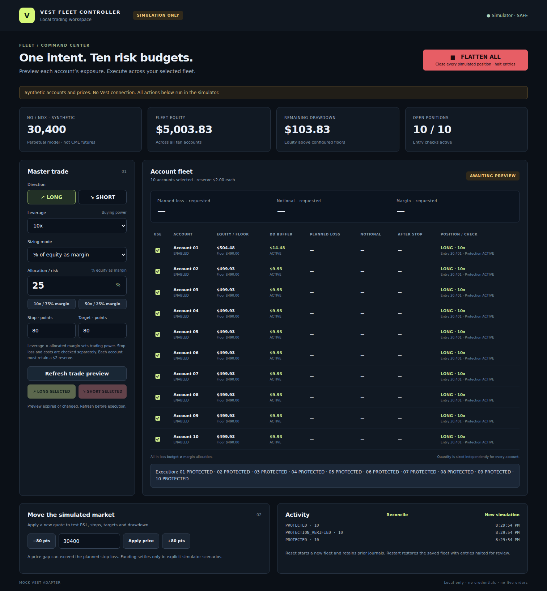

# Simulation dashboard and CLI guide

This guide describes the existing synthetic simulator. It does not describe connected
Vest copy trading. Its sequential execution and fleet-wide failure handling remain
legacy behavior until the independent follower dispatcher replaces them.

For current project status and direction, see the [README](../README.md) and
[implementation checklist](implementation-checklist.md). Screenshots use synthetic
accounts and prices; they are not evidence of live execution.

## Quick start

Native Windows and macOS host identity and private storage are implemented around
the existing simulator. See [native automated results](native-host-validation.md).
Physical desktop/phone checks remain required before customer release; see
[the desktop host gate](desktop-host-support.md).

The [native host setup guide](native-host-setup.md) and
[desktop/phone sanity checklist](desktop-phone-sanity-check.md) describe the
development beta and the evidence required before customer release. Signed Windows
and Mac installation packages are scheduled near final release.

Install **Node.js 24.x** and **pnpm 11.25.0**, then clone the repository using your
GitHub account's access:

```sh
git clone https://github.com/Mahdi451/vest-fleet-controller.git
cd vest-fleet-controller
pnpm install --frozen-lockfile
pnpm dashboard
```

Open **http://127.0.0.1:4173**. Keep the terminal running; press `Ctrl+C` to stop.
Use that exact address rather than `localhost`. The dashboard runs on your computer
and keeps loopback access as the default. For authenticated private phone access, follow
the [native host setup guide](native-host-setup.md). Do not expose it through a public server or proxy.

Each new simulation starts with ten accounts and a synthetic NQ/NDX price of **30,400**:

| Accounts    | Starting session balance | Drawdown floor | Available buffer |
| ----------- | -----------------------: | -------------: | ---------------: |
| 01          |                  $504.55 |           $490 |           $14.55 |
| 02–10, each |                  $500.00 |           $490 |           $10.00 |

## Using the dashboard

1. Select **LONG** or **SHORT**.
2. Choose leverage, sizing mode and allocation or risk amount.
3. Enter stop-loss and take-profit distances in points.
4. Select the accounts that should participate.
5. Click **Refresh trade preview** and review each account's exposure, planned loss,
   remaining buffer and approval status.
6. Click **LONG SELECTED** or **SHORT SELECTED**, then confirm the simulated entry
   within five seconds of the preview. On a phone, use Trade / Accounts / Activity.
7. Apply a synthetic price change to test P&L, stops and targets.

Only approved accounts execute. Changing inputs or selection invalidates the preview.
Presets calculate a preview; they do not place orders. Preview totals include requested
exposure for rejected accounts, so review individual rows before execution.

Positions must close before opening a new trade on the same account. LONG and SHORT
are entry controls, not reversal buttons.



### Flatten and reset

**FLATTEN ALL** attempts to close every account and cancel its protection, including
accounts outside the current selection and disabled accounts. It immediately blocks
new entries and requires no confirmation dialog. Review each account's result;
`UNKNOWN` is not confirmation that the account is safely flat.

After flattening or a circuit halt, **New simulation** starts a fresh fleet. It asks
for confirmation because it resets current balances and positions while preserving
the previous journal. There is no
resume/re-arm control that preserves those balances. Unresolved durable commands block reset;
keep their records for investigation. Restart and reconnect recover status without resubmitting an entry.

## Phone simulation

Customer execution hosts target **Windows and macOS**. Native host identity,
private storage and diagnostics are implemented; physical acceptance is pending.
[Desktop host compatibility](desktop-host-support.md) remains a release acceptance gate;
Linux is a reference environment, not a customer requirement.

The phone layout supports Trade, Accounts and Activity, readable account risk cards,
a persistent SIMULATION badge, entry confirmation and reachable FLATTEN ALL.
Connection reachability and evidence age are displayed separately. Stale/disconnected
entry is blocked; lost responses and reloads query the existing durable command.
No trading command is queued or replayed offline.

See [mobile behavior](mobile-beta.md), [private HTTPS setup and recovery](private-phone-access.md),
and [validation evidence and remaining physical-device checks](mobile-private-validation.md).
Home Screen icons/manifest are included. Physical phone installation and actual host
sleep/reboot are still acceptance tasks; Chromium emulation is the recorded evidence.

## Choosing your exposure

Each account is sized independently using its own balance, equity, drawdown buffer
and modeled costs. Choose what your input represents:

| Sizing mode                  | Your input means                                                                                              |
| ---------------------------- | ------------------------------------------------------------------------------------------------------------- |
| **% of equity as margin**    | Allocate that percentage of the lower of balance or equity as margin, then apply leverage. Dashboard default. |
| **% of remaining drawdown**  | Allocate that percentage of the account's available drawdown to planned loss, including costs.                |
| **Fixed dollar loss budget** | Set the planned dollar loss per account, including costs.                                                     |
| **Fixed notional exposure**  | Request a dollar exposure per account; risk and margin checks still apply.                                    |

**Margin allocation is not loss risk.** For a $500 account, the approximate buying
power is:

| Leverage / allocation | Allocated margin | Buying power |
| --------------------- | ---------------: | -----------: |
| 10x / 25%             |             $125 |       $1,250 |
| 10x / 75%             |             $375 |       $3,750 |
| 50x / 25%             |             $125 |       $6,250 |

Stop distance and costs determine the loss. With an 80-point stop at 30,400, a $10
buffer and the default $2 reserve, the **10x / 75%** and **50x / 25%** examples are
rejected after costs. Account 01's larger buffer can produce a different decision.
The controller does not silently shrink your requested margin allocation to make it pass.

In fixed-dollar and drawdown-risk modes, the loss budget and stop distance determine
size; leverage mainly changes the required margin.

[View the exposure-rejection example](images/dashboard-risk-rejection.png).

### Risk checks

The preview includes entry/exit fees, slippage, funding allowance and account costs.
The planned loss must leave at least the configured reserve—**$2 by default**—above
the drawdown floor. A stop is required in every sizing mode. Gaps and failed protection
can produce losses beyond the estimate.

Opposite-direction NQ/NDX exposure across **enabled** accounts is blocked. Unselected
accounts still count; disabled accounts are excluded from this entry check. Unchecking
an account only changes participation—it does not disable the account or close it.

## Health and reconciliation

The header reports **SAFE**, **DEGRADED**, or **HALTED**. SAFE means the simulator's
books passed a recent check. DEGRADED means data is stale or an operation is in
progress. HALTED means entries are blocked; flatten remains available.

The service checks existing positions and protection every second when idle. Click
**Reconcile** for an immediate check. Unexpected position changes, missing protection
or orphan orders halt entries; unsafe exposure is cleaned up. Reconciliation never
re-arms a halted session. Refresh the trade preview to refresh the synthetic quote.

## Stops, targets and execution results

Protection is created **after the MARKET entry fills**. Final stop and target prices
use the actual fill price, not the preview quote. For a LONG fill at **30,450.25**,
a 25-point stop and 50-point target produce:

- **Stop loss:** 30,425.25
- **Take profit:** 30,500.25

A terminal partial fill receives protection for its actual filled quantity. If the
unfilled remainder cannot be confirmed canceled, execution fails closed.

For SHORT, the stop is above the fill and the target is below it. Both exits are
reduce-only; a filled exit cancels its sibling in the simulator.

| Result      | What it means                                                                                       |
| ----------- | --------------------------------------------------------------------------------------------------- |
| `PROTECTED` | Entry and both protective orders were verified. The controller may continue to the next account.    |
| `REJECTED`  | The account did not receive an approved entry or the entry was confirmed rejected. Read the reason. |
| `UNKNOWN`   | Execution or protection could not be confirmed. Further entries halt; account cleanup is attempted. |
| `HALTED`    | This account was skipped because the controller circuit was open.                                   |

A filled position without confirmed protection is unsafe. If either protective order
cannot be established, the controller attempts to flatten that account and stops
further fleet entries. Earlier protected accounts retain their protection. A successful
cleanup does not change the failed establishment result into `PROTECTED`.

[View the illustrated execution flow](images/execution-flow.png).

## Command line

Preview orders without submitting simulated entries:

```sh
pnpm preview
pnpm preview --mode MARGIN_PERCENT --risk 25 --leverage 10 --stop 80 --target 80
pnpm preview --side SHORT --mode FIXED_DOLLAR --risk 4 --stop 25 --target 50
pnpm preview --json
```

The CLI defaults to LONG, 50x leverage, 40% of remaining drawdown, an 80-point stop
and target, and a synthetic price of 30,400. Its sizing default differs from the dashboard.
Use `--price`, `--side`, `--mode`, `--risk`, `--leverage`, `--stop` and `--target`
to change those inputs. `--risk 40` means 40%, not 0.4%, in percentage modes.

Run a complete scenario:

```sh
pnpm simulate --scenario win
pnpm simulate --scenario loss --side SHORT
pnpm simulate --scenario partial-failure
pnpm simulate --scenario retry
```

| Scenario          | Behavior exercised                                                          |
| ----------------- | --------------------------------------------------------------------------- |
| `win` / `loss`    | Price reaches the target or stop.                                           |
| `partial-failure` | Account 08 rejects; later entries halt.                                     |
| `ambiguous`       | Account 10 fills with an uncertain acknowledgement that must be reconciled. |
| `timeout`         | Account 09 times out; account 10 is blocked.                                |
| `disabled`        | Account 10 is excluded.                                                     |
| `gap`             | Price jumps adversely beyond the stop distance.                             |
| `retry`           | The same request is repeated without duplicating entry.                     |

Each CLI invocation starts a new fleet, applies its scenario and attempts emergency
flatten before exiting. It does not control the dashboard's session. Use the dashboard
for interactive LONG, SHORT and FLATTEN controls.

## Configuration

Edit [config/example.yaml](../config/example.yaml) to change assumptions. Saved sessions
require the same configuration they were created with. To apply changed assumptions,
stop the dashboard and explicitly start a new simulation:

```sh
pnpm dashboard --new-simulation
```

This starts a fresh fleet and retains the previous journal. For a separate CLI profile,
use `--config path/to/profile.yaml`.

| Setting                                 | Default                               |
| --------------------------------------- | ------------------------------------- |
| Entry / exit fees                       | 0.0025% per execution                 |
| Slippage allowance                      | 1 point per side                      |
| Funding allowance                       | 0.01% over the planned holding period |
| Minimum buffer after planned loss       | $2                                    |
| Maximum leverage                        | 50x                                   |
| Preview validity                        | 5 seconds                             |
| Maximum quote movement before rejection | 5 points                              |

These are configurable simulation assumptions, not a verified Vest fee schedule or
market specification. Decimal values in YAML must be quoted strings; time limits are
integer milliseconds. Funding is not automatically charged as time passes.

## Sessions and local data

The dashboard saves balances, positions, entry/protection orders and duplicate-request
records locally. Restarting restores the active session **with entries halted**, then
reconciles it. Valid protected positions remain visible; interrupted or unsafe exposure
triggers cleanup. No market moves are simulated while the application is offline.

Use Reconcile and FLATTEN ALL to review the restored fleet. **New simulation** or
`--new-simulation` explicitly starts over; previous journals remain available. CLI
scenario commands still start isolated fleets.

Audit journals remain on disk:

- Dashboard sessions: `.runtime/dashboard/<session-id>.sqlite`
- CLI runs: `.runtime/<run-id>.sqlite`

The active-session pointer and ownership lock live beside the dashboard journals.
Only one dashboard may use that runtime directory. After a crash, `controller.lock`
may remain: follow the [ownership recovery procedure](native-host-setup.md#8-operate-restart-and-recover).
Only after authoritative owner review may an operator archive the retained lock as
evidence. Leave identity, manifests and all SQLite/WAL files intact. Normal shutdown
releases the owned lock automatically.

Keep the journal when investigating an uncertain result. Do not delete it to bypass
a halt or retry an unresolved trade. No Vest account credentials are needed or stored;
private phone access uses a separate protected host-access secret.

## Troubleshooting

| Message or symptom                                       | What to do                                                                                                    |
| -------------------------------------------------------- | ------------------------------------------------------------------------------------------------------------- |
| `DASHBOARD_START_FAILED`                                 | Check whether port 4173 is already in use.                                                                    |
| `DRAWDOWN_RESERVE`                                       | Reduce exposure or omit the account; planned loss leaves too little buffer.                                   |
| `INSUFFICIENT_MARGIN`                                    | Reduce requested exposure; margin plus entry costs exceeds available funds.                                   |
| `PREVIEW_EXPIRED` or stale data                          | Refresh the preview and review it again.                                                                      |
| `EXISTING_POSITION`                                      | Close the account's current position before opening another.                                                  |
| `CROSS_ACCOUNT_HEDGE_GUARD`                              | An enabled account holds opposite same-market exposure.                                                       |
| `UNKNOWN` or `PROTECTION_UNCONFIRMED`                    | Review account outcomes and attempt FLATTEN ALL. Preserve the journal; do not blindly resend.                 |
| `IDEMPOTENCY_CONFLICT`                                   | A request identity was reused with different inputs; do not reuse it for a different trade.                   |
| `SIMULATION_STORE_LOCKED`                                | Another dashboard owns the runtime directory, or a crash left a lock. Follow the recovery instructions above. |
| `SIMULATION_CONFIG_CHANGED`                              | Restore the saved configuration or explicitly use `--new-simulation` for a fresh fleet.                       |
| `MISSING_SESSION_JOURNAL` / `MISSING_SIMULATOR_SNAPSHOT` | Stop and restore the saved data; do not delete recovery files to force a fresh account state.                 |
| `COMMAND_FAILED`                                         | Check CLI arguments and quoted YAML decimals.                                                                 |
| A CLI run shows starting balances                        | Expected: CLI runs are isolated; the dashboard restores its saved session.                                    |
| A stop loses more than estimated                         | A market gap or costs can exceed the planned allowance; stop fills are not guaranteed at their trigger.       |

---

Maintaining the application? See [DEVELOPMENT.md](../DEVELOPMENT.md) for architecture,
research, milestones, validation, implementation references and development priorities.
