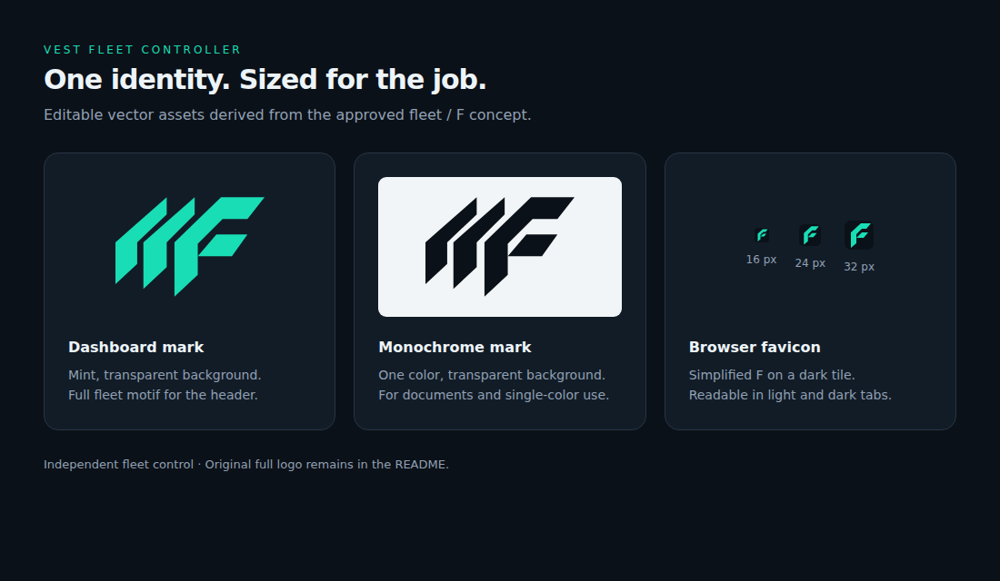

# Visual assets

Updated 2026-09-29. All application captures use the real local simulator with synthetic
accounts and prices. No generated trading UI, fabricated balances or live Vest session
is represented as a screenshot.

The current captures include the SVG header logo, health indicator and Reconcile
action. The capture script also checks header image loading and favicon delivery.

| Asset                                 | Purpose                                                         | Source                                  |
| ------------------------------------- | --------------------------------------------------------------- | --------------------------------------- |
| `images/dashboard-preview.png`        | Ten-account 10x / 25% margin preview                            | Running dashboard                       |
| `images/dashboard-positions.png`      | Ten LONG positions with ACTIVE protection and PROTECTED results | Running dashboard                       |
| `images/dashboard-mobile.png`         | Same protected state at 390px viewport                          | Running dashboard                       |
| `images/dashboard-risk-rejection.png` | 50x / 25% allocation fails reserve checks                       | Running dashboard                       |
| `images/execution-flow.png`           | Fill-based protection, numerical example and failure cleanup    | Editable `images/execution-flow.svg`    |
| `images/logo-concept.png`             | Original independent identity exploration                       | Built-in image generation; concept only |

## Reproduce screenshots

The capture script starts an isolated in-memory dashboard, uses browser controls to
exercise its real behavior, captures the images, then closes the browser and server.
It also renders the exact SVG diagram to PNG. Run from the repository root after the
normal `pnpm install`. Playwright is a documentation-only dependency, deliberately
outside the app's runtime dependencies:

```sh
npm install --prefix /tmp/vest-docs-tools playwright
/tmp/vest-docs-tools/node_modules/.bin/playwright install chromium
PLAYWRIGHT_MODULE_PATH=/tmp/vest-docs-tools/node_modules/playwright \
  node --import tsx scripts/capture-visuals.mjs
```

If Chromium is already available, set `DOCS_CHROMIUM_PATH` to its executable. The
capture uses a local headless browser in a trusted test environment. It sends no live
orders. Browser files and temporary tooling are not committed. Capture time and
process/session IDs naturally vary. Desktop viewport is 1512 × 1120; screenshots use
full page height. Mobile viewport is 390 × 844 with a full-page capture.

## Logo direction

Reference reviewed: [Vest Markets official homepage](https://www.vestmarkets.com/),
2026-09-29. Its official mark was viewed as style reference only and is not redistributed
in this repo. The generated concept uses a different fleet/F symbol with repeated
facets, mint accents, a dark background and the line “Independent fleet control”.
It is not a claim of affiliation or official endorsement.

The raster remains the full concept presentation at the top of the README. The dashboard
uses a clean vector interpretation of its angular fleet/F motif, without raster textures.
Trading controls keep their existing colors; mint identifies the brand.

| Variant               | File under `apps/dashboard/public/brand/` | Usage                                                                                                              |
| --------------------- | ----------------------------------------- | ------------------------------------------------------------------------------------------------------------------ |
| Mint fleet mark       | `mark.svg`                                | Transparent; dashboard header at 60 × 40 px, 42 × 28 px on mobile                                                  |
| Monochrome fleet mark | `mark-mono.svg`                           | Transparent; defaults to black. Inline SVG inherits `currentColor`; an external image does not inherit page color. |
| Small F icon          | `favicon.svg`                             | Simplified central F with a dark tile for contrast in light and dark browser tabs; checked at 16/24/32 px          |



Use the full fleet mark for larger placements. Use the simplified favicon below 32 px;
do not shrink the full wordmark into a browser tab. These SVGs have no embedded scripts,
fonts or external resources. The monochrome variant is a reusable source asset and is
not an exposed dashboard route. No live-trading capability or official affiliation is implied.

### Generation record

Tool: built-in image generation, not the CLI fallback. Output copied unchanged into
`docs/images/logo-concept.png`. Reference: rendered official homepage wordmark, used
only for stylistic context. Final prompt:

> Use case: logo-brand. Create one polished logo concept presentation for an independent open-source-style personal project called 'VEST FLEET CONTROLLER'. Reference image is the official Vest Markets logo, provided ONLY to understand its restrained angular geometry; do not reproduce its silhouette or official wordmark. Invent a clearly distinct, original compact monogram/fleet symbol combining an angular F with three parallel facets or coordinated chevrons, suggesting a fleet moving together and controlled execution. No shield cliches, no candlestick charts, no rising-profit arrows. A simple memorable mark that can work at favicon size. Flat vector-like crisp edges, confident Swiss geometric typography, warm white and mint/teal accents on a uniform very dark navy background (#0b1118), no gradients, no mockup textures, no 3D. Wide landscape approximately 1536x1024. Main composition centered with generous negative space: large original mint symbol left, two-line wordmark on right: 'VEST FLEET' and 'CONTROLLER'. Small understated line below exactly 'Independent fleet control'. The whole composition is one logo lockup, no alternative versions, no interface, no trading claims, no financial figures. Reference only the brand's clean visual discipline while ensuring this looks like our own independent tool.
